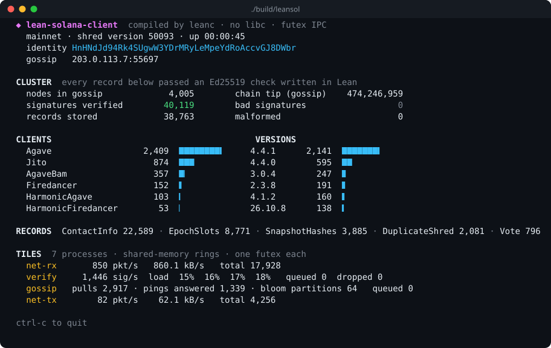
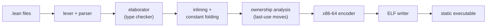
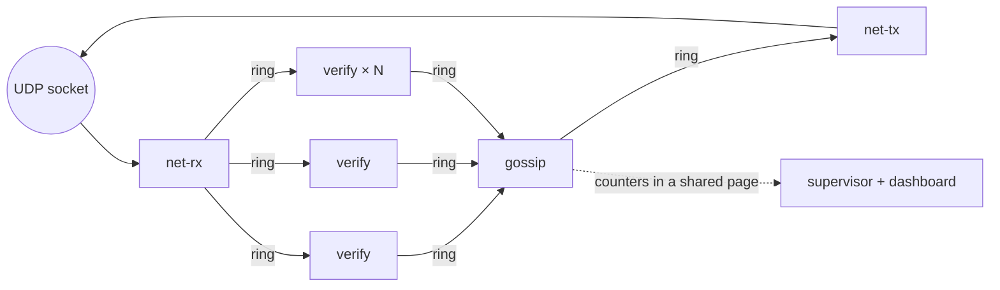

<h1 align="center">lean-solana-client</h1>

<p align="center">
  <b>A Solana client written in Lean 4, compiled by its own zero-dependency Lean&nbsp;→&nbsp;machine-code compiler,<br>
  with processes that talk over nothing but shared memory and a raw futex.</b>
</p>

<p align="center">
  <a href="https://github.com/MidTermDev/lean-Solana-client/actions/workflows/ci.yml"></a>
</p>

<p align="center">
  <a href="#quick-start">Quick start</a> ·
  <a href="#how-it-works">How it works</a> ·
  <a href="#the-lean-you-can-write">The Lean subset</a> ·
  <a href="#checked-against-the-real-lean">Verification</a> ·
  <a href="#numbers">Numbers</a> ·
  <a href="#limits-and-roadmap">Limits</a>
</p>

Inspired by toly's remark that a Lean Solana client would be easy once you have your own dependency-free Lean compiler and a raw futex for IPC. This repository takes that literally:

| the idea | what is in this repo |
|---|---|
| a Solana client in Lean | `client/` — a node that joins Solana's gossip network and verifies what it hears, written in **Lean 4** |
| its own dependency-free Lean → machine compiler | `leanc/` — **Lean 4 in, static x86-64 ELF out**. No LLVM, no C backend, no assembler, no linker, no libc |
| a raw futex for IPC | `lib/Ipc.lean` — lock-free rings in shared memory; the only kernel object is **one futex word** |

<p align="center">
  
</p>

<p align="center"><sub>A real run: 45 seconds after start on mainnet-beta. Every number on that screen comes from records whose Ed25519 signature was checked by code in this repo.</sub></p>

## What it does

`leansol` is a **gossip client**: the kind of node Solana calls a *spy*. Run it and it will

1. resolve an entrypoint with its own DNS resolver and ask it for the cluster's shred version,
2. generate an identity, bind a UDP socket and start sending signed pull requests,
3. answer the ping challenges peers send back, proving it owns its address,
4. receive the cluster's replicated data store (who the nodes are, what they run, which snapshots they hold),
5. **check the Ed25519 signature on every single record** before believing it,
6. draw what it has learned.

All of it — SHA-256, SHA-512, Ed25519, the bloom filters, the wire formats, the hash tables, the DNS query, the terminal UI, the memory allocator underneath — is Lean, compiled to machine code by the compiler in `leanc/`.

**What it is not:** a validator. It does not download blocks, replay transactions, vote, or produce anything. It observes and verifies the gossip plane. See [Limits and roadmap](#limits-and-roadmap) for exactly where the line is.

## Quick start

**Just run it.** Every release ships the client as a single 180 KB static binary (Linux, x86-64):

```sh
curl -LO https://github.com/MidTermDev/lean-Solana-client/releases/latest/download/leansol-x86_64-linux
chmod +x leansol-x86_64-linux
./leansol-x86_64-linux        # joins mainnet-beta gossip
```

**Or build it.** You need Linux on x86-64 and `make`. No C compiler, no Lean installation, nothing else:

```sh
git clone https://github.com/MidTermDev/lean-Solana-client
cd lean-Solana-client
make              # Lean source in, ELF out: about 40 milliseconds
./build/leansol   # joins mainnet-beta gossip
```

Within a few seconds you should see nodes pouring in. `ctrl-c` quits. `--cluster testnet` and `--cluster devnet` work the same way.

```
usage: leansol [options]
  --cluster NAME      mainnet (default), testnet or devnet
  --entrypoint HOST   gossip entrypoint to join through (host or host:port; repeatable)
  --port N            UDP port to bind (default: chosen by the kernel)
  --tiles N           number of signature-verification processes (default 4, max 16)
  --fanout N          peers pulled from every 200 ms, besides entrypoints (default 12)
  --duration SECONDS  exit after this long (default: run until interrupted)
  --plain             one status line per second instead of the dashboard
  --json              print everything learned as one JSON document on exit
                      (status lines go to stderr; runs 30 s unless --duration is given)
  --json-file PATH    rewrite PATH with that JSON document every 5 seconds
  --metrics [IP:]PORT serve Prometheus metrics at /metrics and the JSON at /nodes.json
                      (binds 127.0.0.1 unless an IP is given; 0.0.0.0 for all interfaces)
  --help              this text
```

Piped or redirected, it switches to log lines automatically:

```console
$ ./build/leansol --duration 5 | cat
[00:00:01] nodes=157 tip=474244559 verified=882 bad=0 malformed=0 stored=313 sig/s=882 rx=168967B/s pulls=29 pongs=10
[00:00:02] nodes=606 tip=474244559 verified=1872 bad=0 malformed=0 stored=1129 sig/s=990 rx=192508B/s pulls=83 pongs=37
[00:00:03] nodes=1263 tip=474244559 verified=2690 bad=0 malformed=0 stored=2387 sig/s=818 rx=155928B/s pulls=137 pongs=66
...
```

It needs outbound UDP, and outbound TCP to the entrypoint's gossip port (8001) for the initial "what is my address" request. Nothing has to be opened inbound: peers reply to the address your requests come from.

Other targets:

```sh
make test         # compile and run the test suite with leanc
make verify-seed  # optional: rebuild the compiler from its C source and compare outputs
make lean-check   # optional: type-check everything with the official Lean toolchain too
```

## Use the data

The dashboard is for people. For everything else there are three machine-readable outputs, all describing the same thing: the cluster as this node has verified it.

**A JSON snapshot.** Listen for a while, print one document, exit:

```console
$ ./build/leansol --json --duration 20 > cluster.json
$ jq -c .clients cluster.json
{"Agave":2232,"Jito":854,"AgaveBam":352,"Firedancer":150,"HarmonicAgave":101,"HarmonicFiredancer":49,"FireBAM":21,"other":17,"Rakurai":12,"Raiku":4,"Frankendancer":1}
$ jq '.nodes[0]' cluster.json
{
  "identity": "HBNYZTJWrCjjm38MR1c5vpua1E2w1GPiKL9QhKsVgHaN",
  "gossip": "37.72.171.250:8000",
  "client": "Agave",
  "clientId": 3,
  "version": "4.4.1",
  "shredVersion": 50093,
  "wallclockMs": 1795719432671,
  "snapshotSlot": 474237159
}
$ jq -r '.nodes[] | select(.client == "Firedancer") | .identity' cluster.json | head -3
PKb1GJrwtu1zuCQNS8SwPUwowSDbBbvPGsHj7ynTB9y
VQwCCSfW3o5NDx7n5FBr9SoYiLXVgetstHvaWBvv2YH
4Ha5nncB2reFpQW6SEjbEAfrbXHp3crCeUz5u7zSRBYa
```

The document has the summary (`nodeCount`, `tipSlot`, `signaturesVerified`, …), the `clients` and `versions` breakdowns ordered by popularity, and one entry per node. Twenty seconds finds most of mainnet; a minute finds essentially all of it.

**A file that stays fresh.** For a long-running node, `--json-file cluster.json` rewrites the same document every 5 seconds. The write is atomic (temporary file, then `rename`), so readers never see half a file.

**Prometheus metrics and JSON over HTTP.** `--metrics 9184` adds a small HTTP server:

```console
$ ./build/leansol --metrics 9184 &
$ curl -s localhost:9184/metrics | grep -E '^leansol_(nodes |tip_slot|signatures|nodes_by_client)'
leansol_nodes 3793
leansol_tip_slot 474256571
leansol_signatures_verified_total 16286
leansol_signatures_bad_total 0
leansol_nodes_by_client{client="Agave"} 2232
leansol_nodes_by_client{client="Jito"} 854
leansol_nodes_by_client{client="AgaveBam"} 352
leansol_nodes_by_client{client="Firedancer"} 150
...
$ curl -s localhost:9184/nodes.json | jq .nodeCount
3793
```

| path | what |
|---|---|
| `/metrics` | Prometheus text format: counters, the chain tip, `leansol_nodes_by_client{client=…}`, `leansol_nodes_by_version{version=…}`, `leansol_records_total{type=…}` |
| `/nodes.json` | the same JSON document as `--json`, generated on request |

It listens on `127.0.0.1` unless you say otherwise (`--metrics 0.0.0.0:9184`). There is no authentication or TLS, so put it behind something if you expose it. A scrape config is one line: `- targets: ['localhost:9184']`.

Like everything else here, the server is Lean: `socket`, `listen`, `accept` by syscall number, an HTTP request parser of a dozen lines, and a tile of its own that reads the shared pages without disturbing the others.

### Compile your own Lean

`leanc` is a general compiler for its [subset of Lean](#the-lean-you-can-write), not a one-program trick:

```lean
-- hello.lean
def greet (name : String) : String := s!"hello, {name}"

def main : IO Unit := do
  IO.println (greet "world")
```

```console
$ ./build/leanc -I rt -o hello hello.lean && ./hello
hello, world
$ file hello
hello: ELF 64-bit LSB executable, x86-64, version 1 (SYSV), statically linked, no section header
$ strace ./hello
execve("./hello", ["./hello"], ...)     = 0
mmap(NULL, 4194304, PROT_READ|PROT_WRITE, MAP_PRIVATE|MAP_ANONYMOUS, -1, 0) = 0x7ef55fc00000
write(1, "hello, world\n", 13)          = 13
exit_group(0)                           = ?
```

Four syscalls, start to finish. There is no dynamic loader, no libc initialisation, nothing running that you did not write.

## How it works

### 1. `leanc`: Lean → x86-64, with nothing in between



The official Lean compiler turns Lean into C and hands it to a C toolchain, which brings LLVM, a linker and libc along. `leanc` skips all of that: it reads Lean source and writes the bytes of an executable itself, instruction encodings, jump fix-ups, ELF program headers and all. No C is generated and no C toolchain runs at any point.

**"No dependencies" is meant literally:**

- The compiler binary itself is **freestanding**: built with `-nostdlib -ffreestanding -static`, it has zero undefined symbols and reaches the kernel through seven raw syscalls (`read`, `write`, `open`, `close`, `unlink`, `mmap`, `exit_group`).
- Its output is **freestanding** too. There is no C runtime underneath compiled programs.
- The runtime is **written in Lean** ([`rt/Rt.lean`](rt/Rt.lean)) and compiled along with your program: the allocator, growable arrays, strings, printing, panics.
- **Building needs no C toolchain either.** A prebuilt `leanc` is checked in ([`bootstrap/`](bootstrap/)), so `make` goes from Lean source to executable with no compiler installed. The compiler's own source is C; `make verify-seed` rebuilds it with whatever C compiler you have and requires byte-identical output, which holds for gcc and clang, as C99, C11 or C23.

Under the runtime sit a handful of **intrinsics** that `leanc` turns straight into instructions. In Lean they are ordinary `opaque` declarations:

```lean
@[extern "leanc_syscall"] opaque syscall (n a b c d e f : UInt64) : IO UInt64   -- syscall
@[extern "leanc_load64"]  opaque load64 (addr : UInt64) : IO UInt64            -- mov rax, [rax]
@[extern "leanc_copy"]    opaque copy (dst src n : UInt64) : IO Unit           -- rep movsb
@[extern "leanc_xadd64"]  opaque xadd64 (addr delta : UInt64) : IO UInt64      -- lock xadd
```

Everything else is built from those. `malloc` is thirty lines of Lean calling `mmap`.

**Functional code, in-place updates.** Lean values are immutable, yet `arr.set! i v` must not copy a megabyte array on every write. Lean's answer is reference counting: if you hold the only reference, the update happens in place. `leanc` implements the same idea. A backward liveness pass finds the last use of every variable and turns it into a *move*, so a loop like this mutates one buffer and never copies:

```lean
for i in [16:64] do
  w := w.set! i (w[i - 16]! + s0 + w[i - 7]! + s1)
```

Destructuring a value you own hands you its fields for free, so the client's hash tables are plain immutable structures that are nonetheless updated in place. [`tests/inplace.lean`](tests/inplace.lean) fails if that ever regresses into copying.

**Small things that matter for crypto code.** `@[inline]` helpers are inlined and constant-folded, and the classic rotate idiom becomes one instruction:

```lean
@[inline] def rotr (x : UInt32) (n : UInt32) : UInt32 := (x >>> n) ||| (x <<< (32 - n))
-- rotr e 6   compiles to:   mov eax, [rbp-48] ; ror eax, 6
```

### 2. IPC on a raw futex

The client is several processes (see below). They communicate through single-producer/single-consumer rings in `MAP_SHARED` memory, set up before `fork`. Sending a message is a `rep movsb` into the ring plus one `lock xadd`. **No syscall happens unless the receiver is actually asleep**, and then it is exactly one `FUTEX_WAKE`.

There are no pipes, sockets, eventfds, semaphores or mutexes. The single kernel service used is the futex syscall, called by number:

```lean
def futexWait (addr expected timeoutMs : UInt64) : IO Unit := do
  ...
  let _ ← syscall 202 addr 0 expected (p + 24) 0 0     -- FUTEX_WAIT
```

The hard part of any such design is not losing a wake-up when the consumer decides to sleep at the same instant the producer publishes. Both sides follow a Dekker-style handshake in which each side's store is a *locked* instruction, so at least one of them always sees the other:

```
consumer                              producer
--------                              --------
xchg  sleeping := 1                   lock xadd  head += 1          (publish)
seq := load futexWord                 if load sleeping != 0:
if rings still empty:                     lock xadd  futexWord += 1
    futex_wait(futexWord, seq)            futex_wake(futexWord)
sleeping := 0
```

If the publish lands after the consumer's emptiness check, the producer is guaranteed to see `sleeping = 1`; it bumps the futex word, and the kernel refuses to sleep on the now-stale `seq`. If it lands before, the consumer's check finds the message. The whole mechanism is 180 lines: [`lib/Ipc.lean`](lib/Ipc.lean).

### 3. The client: tiles

Borrowing Firedancer's vocabulary, each job is a *tile*: one process, one responsibility, connected to its neighbours by rings.



| tile | what it does | file |
|---|---|---|
| **net-rx** | blocks in `recvfrom`, fans datagrams out to the verify tiles | [`client/NetTiles.lean`](client/NetTiles.lean) |
| **verify** ×N | splits messages into records, runs Ed25519 on each, forwards only what verified | [`client/VerifyTile.lean`](client/VerifyTile.lean) |
| **gossip** | the protocol: identity, CRDS store, bloom filters, pull requests, pongs | [`client/GossipTile.lean`](client/GossipTile.lean) |
| **net-tx** | sleeps on its futex, sends what gossip queues | [`client/NetTiles.lean`](client/NetTiles.lean) |
| **http** (optional) | serves `/metrics` and `/nodes.json` from the shared pages | [`client/HttpTile.lean`](client/HttpTile.lean) |
| **supervisor** | forks the tiles, watches them, draws the dashboard from shared counters | [`client/Main.lean`](client/Main.lean) |

The split is also a security boundary: the gossip tile, which holds the identity key and the state, only ever sees input that a verify tile has authenticated.

The node table lives in the gossip tile. Other processes read it through a shared mapping guarded by a **seqlock**: the writer bumps a counter to an odd value, copies the table in, and bumps it again; a reader copies the table out and retries if the counter changed meanwhile. The writer never waits, which is the property you want when the writer is the protocol loop ([`client/Directory.lean`](client/Directory.lean)).

**Joining the cluster**, step by step:

1. **Find out who we are.** Entrypoints run an "IP echo" service on their gossip port. One small TCP exchange returns our public address and the cluster's *shred version* (50093 on mainnet at the time of writing), which every gossip message must match.
2. **Introduce ourselves.** A pull request carries our signed `ContactInfo` and a bloom filter describing the records we already hold, so peers send only what is missing. The record-hash space is split into partitions; each request covers one.
3. **Get challenged.** Before answering, a peer sends a `Ping` with a random token. We reply with a `Pong`: the SHA-256 of the token, signed. That proves the address is ours and not spoofed.
4. **Listen.** Pull responses arrive: `ContactInfo`, `SnapshotHashes`, `EpochSlots`, votes, duplicate-shred proofs. Each is a `CrdsValue`, a signature followed by data, owned by whichever key signed it.
5. **Verify, then believe.** The format is not self-delimiting, so [`lib/Solana/Crds.lean`](lib/Solana/Crds.lean) knows the layout of all 14 record types well enough to find each record's end and its owner's key. Then Ed25519, with the same strict rules validators use.

**What the numbers on the dashboard mean, and how far to trust them:**

- *Nodes in gossip* counts distinct identities with a validly signed `ContactInfo`. Each node vouches only for itself.
- *Chain tip (gossip)* is the third-highest slot among the snapshot announcements seen, so at least three different signers agree the chain is at least that far. In practice it trails the real tip by a few hundred slots at most. It is corroborated hearsay, **not** a verified ledger position.
- *Bad signatures* should sit at zero, and does. During development it briefly did not: 0.3% of records failed, all of one type. Python's Ed25519 accepted every one of them, which pointed at this repo's SHA-512, which had a padding bug for messages whose length is 112–119 mod 128. An all-lengths test now covers it. Real traffic is a good fuzzer.

## The Lean you can write

`leanc` compiles a deliberately small, first-order fragment of Lean 4. Everything in this repository stays inside it.

| | supported |
|---|---|
| **Definitions** | `def`, `partial def`, `structure` (with defaults), `inductive` (enums and constructors with fields), `abbrev` for types, `namespace` / `open` / `import`, `@[inline]`, `@[extern]` |
| **Types** | `Nat`, `UInt8/16/32/64`, `USize`, `Bool`, `Char`, `String`, `ByteArray`, `Array α`, `Option α`, `α × β`, `Unit`, structures, inductives, `IO α` |
| **Expressions** | function application, `if`, `match` (nested, multi-scrutinee, alternatives), `let` and destructuring `let`, `⟨…⟩`, `{ x := … }`, `{ s with … }`, `#[…]`, `a[i]!`, `s!"…{e}…"`, `x.f` method calls, `.ctor`, `|>.`, `<\|` |
| **`do` notation** | `let`, `let mut`, `←`, `(← e)`, reassignment, `if`/`unless`, `for x in [a:b]` / arrays / byte arrays, `while`, `repeat`, `break`, `continue`, `return`, `match`, in both `IO` and `Id.run do` |
| **Library** | integer arithmetic, bit operations and conversions, `Array` and `ByteArray` basics, `String` basics, `IO.println`, `IO.sleep`, `IO.monoMsNow`, `IO.getRandomBytes`, … |

Not supported: type classes, polymorphic or higher-order functions, lambdas, dependent types, tactics, `List`, exceptions, and most of the standard library. Declarations `leanc` has no use for (`theorem`, `instance`, `deriving`) are parsed and skipped, so files can carry proofs and instances for the official toolchain.

**Where `leanc` deliberately differs from Lean:**

- **`Nat` is a 64-bit machine word.** Lean's `Nat` is unbounded. `leanc` never silently wraps it: addition, multiplication and shifts that would overflow *trap*, and subtraction truncates at zero as in Lean. So if a program runs without a "Nat overflow" panic, its `Nat` results are the ones Lean would compute.
- **No tail calls.** Recursion uses the machine stack and is not turned into a loop, so long-running loops should be `while`/`for`/`repeat`.
- **Panics abort.** `a[i]!` out of bounds stops the process with a message and line number. (Official Lean logs and continues with a default value.)
- **`leanc` does not check proofs.** It is a compiler, not a kernel. Whether a file is valid Lean is for the official toolchain to say; this repo keeps that check one command away.

## Checked against the real Lean

A home-made compiler for a subset is only interesting if it agrees with the real thing, so the repository is *also* an ordinary Lake project:

```sh
make lean-check    # = lake build && tests/run.sh --oracle     (needs the official toolchain)
```

- **`lake build`** makes the official Lean 4 toolchain type-check every Lean file here: runtime, libraries, client. The whole client is accepted by both compilers from the same source.
- **Differential tests.** Each program in `tests/` is compiled by `leanc` and run; its output must equal `tests/expected/`, which was generated by running the same file under official Lean. They cover value semantics under aliasing, pattern matching, control flow, integer edge cases, SHA-2 at every message length from 0 to 300, Ed25519 signing and verification, and a fuzz run that throws 16,000 random and corrupted records at the wire parsers (which must neither crash nor disagree). Continuous integration runs both this and the plain build on every push.
- **External references.** The crypto is additionally checked against Python's `hashlib` and `cryptography`, RFC 8032 vectors, and, continuously, mainnet itself.

```console
$ make lean-check
Build completed successfully (58 jobs).
ok    basics (official Lean agrees)
ok    ed25519 (official Lean agrees)
ok    fuzz_wire (official Lean agrees)
ok    inplace (native only)
ok    ipc (native only)
ok    panic (aborted with a bounds panic, as it must)
ok    semantics (official Lean agrees)
ok    sha (official Lean agrees)
ok    sha_lengths (official Lean agrees)
ok    tables (official Lean agrees)
ok    text (official Lean agrees)
11 passed, 0 failed
```

The tests not marked "official Lean agrees" either use raw syscalls (`fork`, futexes), which exist only as machine code, or check behaviour specific to `leanc` (aborting on a bounds error, in-place updates).

## Numbers

Measured on one machine (Xeon Gold 5515+), single core unless noted. They are here to give a sense of scale, not as a benchmark suite.

| | |
|---|---|
| `leanc` source | about 5,800 lines of C |
| `leanc` binary | 143 KB, static, zero undefined symbols |
| Lean in this repo | 4,100 lines: runtime 565, libraries 2,271, client 1,230 |
| Compiling the whole client | **under 30 ms** |
| `leansol` binary | **180 KB**, static |
| Full build from a fresh clone | about 40 ms |
| Ed25519 verification (Lean, compiled by `leanc`) | about 2,950 signatures/s per core |
| SHA-256 (Lean, compiled by `leanc`) | about 72 MB/s |
| Futex ring, two processes | 200,000 messages in 0.16 s |
| Mainnet, 45 s after start | 4,005 nodes, 40,119 signatures verified, 0 bad |
| Mainnet, steady state | about 12% of a core per verify tile, 7% for gossip; memory flat |

`leanc` generates simple code: values live in the stack frame, there is no register allocator. It is fast enough for this job with room to spare, and nowhere near a production compiler. The same SHA-256 test takes the official Lean *interpreter* about 200 times longer, which is the only fair comparison available without pulling in a C toolchain.

## Repository map

```
bootstrap/leanc   the compiler, prebuilt: what `make` uses
leanc/            the compiler's source (C, freestanding)
  lex.c parse.c     Lean's grammar, including the column-sensitive parts
  elab.c            type checker; inlining and constant folding
  live.c            ownership analysis: which uses can move instead of copy
  gen.c             x86-64 encoder, reference counting, ELF writer
rt/Rt.lean        the runtime, in Lean: allocator, arrays, strings, panics
lib/
  Sys.lean          Linux syscalls: sockets, fork, mmap, futex, clocks
  Ipc.lean          futex-backed rings and counters in shared memory
  Crypto/           SHA-256, SHA-512, Ed25519 (field, curve, scalars, sign, verify)
  Solana/           wire formats, all CRDS record layouts, gossip messages, hash tables
  Net/              IPv4 helpers and a DNS stub resolver
  Encoding/         hex, Base58
client/           the tiles, the dashboard, the JSON/Prometheus export, main
tests/            programs + outputs produced by official Lean
lakefile.toml     lets the official toolchain check all of the above
```

## Limits and roadmap

Being straightforward about what this is:

- **A gossip client, not a validator.** No blocks, no replay, no voting, no ledger verification. Getting from here to following the chain trustlessly means speaking the repair and turbine protocols, reassembling shreds (Reed–Solomon, Merkle proofs), and checking proof-of-history. That is the natural next step and none of it exists yet.
- **Listen-only.** It answers pings but does not serve pull requests or push records to others, and its identity is fresh on every start.
- **A simple store.** Records are remembered by hash, up to 400,000; when that fills (every several minutes on mainnet) the hash set is flushed and refilled rather than aged out record by record. The node table survives the flush.
- **x86-64 Linux only.** The code generator and the syscall numbers are specific to it.
- **The compiler is not self-hosted.** Its source is C. Nothing in the build uses a C toolchain, because a prebuilt compiler is checked in, but changing the compiler does.
- **A subset of Lean.** No type classes or higher-order functions is a real restriction; the libraries here are written around it.
- **`Nat` is 64 bits** (overflow traps rather than wraps; see above).
- **Young code.** The compiler has been exercised by about 4,100 lines of Lean and the test suite, not by years of users. The Ed25519 implementation is variable-time, which is fine for verifying public data and not what you want around long-lived secret keys.
- **The network moves.** Wire formats follow agave's current gossip code; when the protocol changes, this needs to follow.

## FAQ

**Is this the Lean theorem prover's language, or just "lean" as in small?**
Both. The client is written in Lean 4, the language of the theorem prover, and the result is also small: a 180 KB static binary.

**Is there really no C toolchain involved?**
Not in building or running anything here: `make` uses the checked-in `leanc` binary, which compiles Lean straight to an ELF. The compiler's *source* is C, so changing the compiler itself needs a C compiler (`make from-c`). The remaining step is for `leanc` to be written in Lean and compile itself; its subset is not there yet.

**Does anything here use the official Lean compiler or its runtime?**
No. `make` never touches them. The official toolchain is used only as an independent checker (`make lean-check`), and is optional.

**Are there proofs?**
Not yet. The code is ordinary Lean that the official toolchain type-checks, which is what makes proofs *possible*: statements about, say, the wire parsers never reading out of bounds could be proved in the same files and would be erased by `leanc`. Today the assurance comes from differential testing, not theorems.

**Is it safe to run?**
It opens one UDP socket, makes outbound connections to public Solana nodes, and writes nothing to disk. Your address becomes visible to the gossip network, as it does for any node.

## Acknowledgements

- toly, for the idea.
- [Firedancer](https://github.com/firedancer-io/firedancer), for the tile architecture this borrows its vocabulary from.
- [Agave](https://github.com/anza-xyz/agave), whose gossip implementation is the reference for the wire formats.
- [Lean 4](https://lean-lang.org), for a language worth writing a second compiler for.

## License

MIT. See [LICENSE](LICENSE).
