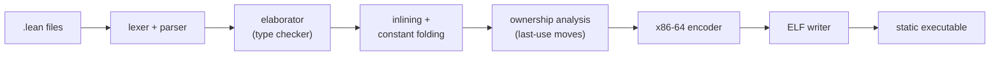
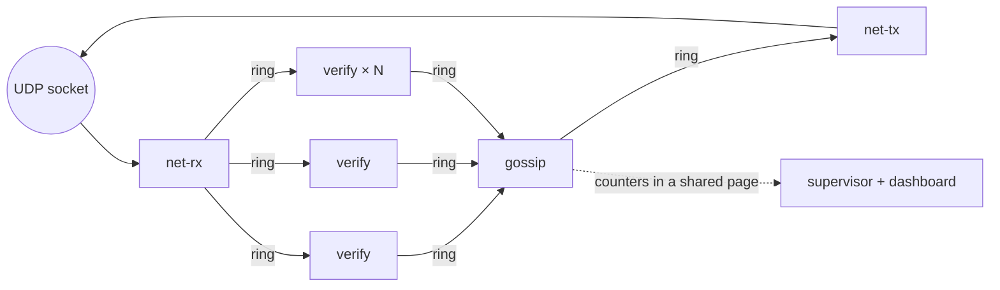

<h1 align="center">lean-solana-client</h1>

<p align="center">
  <b>A Solana client written in Lean 4, compiled by its own zero-dependency Lean&nbsp;→&nbsp;machine-code compiler,<br>
  with processes that talk over nothing but shared memory and a raw futex.</b>
</p>

<p align="center">
  <a href="https://github.com/MidTermDev/lean-Solana-client/actions/workflows/ci.yml"></a>
</p>

<p align="center">
  <b><a href="https://leansvm.com">leansvm.com</a></b>: a node running this code, live on mainnet
</p>

<p align="center">
  <a href="#quick-start">Quick start</a> ·
  <a href="#how-it-works">How it works</a> ·
  <a href="#the-lean-you-can-write">The Lean subset</a> ·
  <a href="#checked-against-the-real-lean">Verification</a> ·
  <a href="#numbers">Numbers</a> ·
  <a href="#limits-and-roadmap">Limits</a>
</p>

Inspired by toly's remark that a Lean Solana client would be easy once you have your own dependency-free Lean compiler and a raw futex for IPC. This repository takes that literally:

| the idea | what is in this repo |
|---|---|
| a Solana client in Lean | `client/` — a node that joins Solana's gossip network and verifies what it hears, written in **Lean 4** |
| its own dependency-free Lean → machine compiler | `leanc/` — **Lean 4 in, static x86-64 ELF out**. No LLVM, no C backend, no assembler, no linker, no libc |
| a raw futex for IPC | `lib/Ipc.lean` — lock-free rings in shared memory; the only kernel object is **one futex word** |

And since toly then published [lean-svm](https://github.com/aeyakovenko/lean-svm), which compiles Lean into on-chain programs, there is a fourth piece: an **sBPF virtual machine** (`lib/Solana/Sbpf.lean`), also in Lean, that runs those programs, including the ones that call the real SPL token programs, and runs Rust programs built with Anchor too. Lean on both sides of the bytecode.

<p align="center">
  
</p>

<p align="center"><sub>A real run: 45 seconds after start on mainnet-beta. Every number on that screen comes from records whose Ed25519 signature was checked by code in this repo.</sub></p>

## What it does

`leansol` is a **gossip client**: the kind of node Solana calls a *spy*. Run it and it will

1. resolve an entrypoint with its own DNS resolver and ask it for the cluster's shred version,
2. generate an identity, bind a UDP socket and start sending signed pull requests,
3. answer the ping challenges peers send back, proving it owns its address,
4. receive the cluster's replicated data store (who the nodes are, what they run, which snapshots they hold),
5. **check the Ed25519 signature on every single record** before believing it,
6. draw what it has learned.

All of it — SHA-256, SHA-512, Ed25519, the bloom filters, the wire formats, the hash tables, the DNS query, the terminal UI, the memory allocator underneath — is Lean, compiled to machine code by the compiler in `leanc/`.

It **replays mainnet blocks** against that state and arrives at the bank hashes their leaders signed (see [Replay](#replay)); it **verifies real blocks** and follows the chain (see [Verify blocks](#verify-blocks)), **loads the chain's state** from a snapshot, checking every account (see [Hold the state](#hold-the-state)), **runs on-chain programs** locally with `leansol run`, and applies whole signed **transactions** with `leansol tx`: see [Run on-chain programs](#run-on-chain-programs).

**What it is not:** a validator. It does not execute the blocks it receives, vote, or produce anything. It observes and verifies. See [Limits and roadmap](#limits-and-roadmap) for exactly where the line is.

## Quick start

**Just run it.** Every release ships the client as a single 793 KB static binary (Linux, x86-64):

```sh
curl -LO https://github.com/MidTermDev/lean-Solana-client/releases/latest/download/leansol-x86_64-linux
chmod +x leansol-x86_64-linux
./leansol-x86_64-linux        # joins mainnet-beta gossip
```

**Or build it.** You need Linux on x86-64 and `make`. No C compiler, no Lean installation, nothing else:

```sh
git clone https://github.com/MidTermDev/lean-Solana-client
cd lean-Solana-client
make              # Lean source in, ELF out: about 40 milliseconds
./build/leansol   # joins mainnet-beta gossip
```

Within a few seconds you should see nodes pouring in. `ctrl-c` quits. `--cluster testnet` and `--cluster devnet` work the same way.

```
usage: leansol [options]
  --cluster NAME      mainnet (default), testnet or devnet
  --entrypoint HOST   gossip entrypoint to join through (host or host:port; repeatable)
  --port N            UDP port to bind (default: chosen by the kernel)
  --tiles N           number of signature-verification processes (default 4, max 16)
  --fanout N          peers pulled from every 200 ms, besides entrypoints (default 12)
  --duration SECONDS  exit after this long (default: run until interrupted)
  --plain             one status line per second instead of the dashboard
  --identity FILE     keep the node's key in FILE so its identity survives restarts
                      (created on first use; default: a fresh identity every run)
  --json              print everything learned as one JSON document on exit
                      (status lines go to stderr; runs 30 s unless --duration is given)
  --json-file PATH    rewrite PATH with that JSON document every 5 seconds
  --tvu-port N        receive every block: advertise UDP port N for shreds and listen on it.
                      Both it and --port must be reachable from the internet (validators ping the
                      gossip port before they believe a node exists); they may be the same port.
  --follow-tiles N    processes that assemble and verify the blocks received that way (default 6)
  --state DIR         a store loaded by `leansol snapshot`: the stakes in its manifest give the
                      leader schedule, and each block must then be signed by its slot's leader
  --block-interval S  without a shred port: fetch a recent block from validators and verify it every S seconds
                      (default 5; 0 = never)
  --metrics [IP:]PORT serve Prometheus metrics at /metrics and the JSON at /nodes.json
                      (binds 127.0.0.1 unless an IP is given; 0.0.0.0 for all interfaces)
  --help              this text

       leansol run PROGRAM.so [options]   execute an on-chain program locally
                                          (see `leansol run --help`)
       leansol tx TRANSACTION [options]   apply a signed transaction to accounts, locally
                                          (see `leansol tx --help`)
       leansol block [SLOT] [options]     fetch a block from the cluster and verify it
                                          (see `leansol block --help`)
       leansol snapshot [options]         load the chain's state from a snapshot, verifying it
       leansol account ADDRESS            look an account up in the loaded state
                                          (see `leansol snapshot --help`)
       leansol replay [options]           execute blocks against the loaded state and compare
                                          bank hashes (see `leansol replay --help`)
```

Piped or redirected, it switches to log lines automatically:

```console
$ ./build/leansol --duration 5 | cat
[00:00:01] nodes=157 tip=474244559 verified=882 bad=0 malformed=0 stored=313 sig/s=882 rx=168967B/s pulls=29 pongs=10
[00:00:02] nodes=606 tip=474244559 verified=1872 bad=0 malformed=0 stored=1129 sig/s=990 rx=192508B/s pulls=83 pongs=37
[00:00:03] nodes=1263 tip=474244559 verified=2690 bad=0 malformed=0 stored=2387 sig/s=818 rx=155928B/s pulls=137 pongs=66
...
```

It needs outbound UDP, and outbound TCP to the entrypoint's gossip port (8001) for the initial "what is my address" request. Nothing has to be opened inbound: peers reply to the address your requests come from.

Other targets:

```sh
make test         # compile and run the test suite with leanc
make verify-seed  # optional: rebuild the compiler from its C source and compare outputs
make lean-check   # optional: type-check everything with the official Lean toolchain too
```

## Use the data

The dashboard is for people. For everything else there are three machine-readable outputs, all describing the same thing: the cluster as this node has verified it.

**A JSON snapshot.** Listen for a while, print one document, exit:

```console
$ ./build/leansol --json --duration 20 > cluster.json
$ jq -c .clients cluster.json
{"Agave":2232,"Jito":854,"AgaveBam":352,"Firedancer":150,"HarmonicAgave":101,"HarmonicFiredancer":49,"FireBAM":21,"other":17,"Rakurai":12,"Raiku":4,"Frankendancer":1}
$ jq '.nodes[0]' cluster.json
{
  "identity": "HBNYZTJWrCjjm38MR1c5vpua1E2w1GPiKL9QhKsVgHaN",
  "gossip": "37.72.171.250:8000",
  "client": "Agave",
  "clientId": 3,
  "version": "4.4.1",
  "shredVersion": 50093,
  "wallclockMs": 1795719432671,
  "snapshotSlot": 474237159
}
$ jq -r '.nodes[] | select(.client == "Firedancer") | .identity' cluster.json | head -3
PKb1GJrwtu1zuCQNS8SwPUwowSDbBbvPGsHj7ynTB9y
VQwCCSfW3o5NDx7n5FBr9SoYiLXVgetstHvaWBvv2YH
4Ha5nncB2reFpQW6SEjbEAfrbXHp3crCeUz5u7zSRBYa
```

The document has the summary (`nodeCount`, `tipSlot`, `signaturesVerified`, …), the `clients` and `versions` breakdowns ordered by popularity, and one entry per node. Twenty seconds finds most of mainnet; a minute finds essentially all of it.

**A file that stays fresh.** For a long-running node, `--json-file cluster.json` rewrites the same document every 5 seconds. The write is atomic (temporary file, then `rename`), so readers never see half a file.

**Prometheus metrics and JSON over HTTP.** `--metrics 9184` adds a small HTTP server:

```console
$ ./build/leansol --metrics 9184 &
$ curl -s localhost:9184/metrics | grep -E '^leansol_(nodes |tip_slot|signatures|nodes_by_client)'
leansol_nodes 3793
leansol_tip_slot 474256571
leansol_signatures_verified_total 16286
leansol_signatures_bad_total 0
leansol_nodes_by_client{client="Agave"} 2232
leansol_nodes_by_client{client="Jito"} 854
leansol_nodes_by_client{client="AgaveBam"} 352
leansol_nodes_by_client{client="Firedancer"} 150
...
$ curl -s localhost:9184/nodes.json | jq .nodeCount
3793
```

| path | what |
|---|---|
| `/metrics` | Prometheus text format: counters, the chain tip, `leansol_nodes_by_client{client=…}`, `leansol_nodes_by_version{version=…}`, `leansol_records_total{type=…}` |
| `/summary.json` | totals and the client/version breakdown: a kilobyte or so, cheap to poll |
| `/nodes.json` | the same plus every node: the document `--json` prints, generated on request |

It listens on `127.0.0.1` unless you say otherwise (`--metrics 0.0.0.0:9184`). There is no authentication or TLS, so put it behind something if you expose it. A scrape config is one line: `- targets: ['localhost:9184']`.

### Run a public node

The node behind [leansvm.com](https://leansvm.com) is this binary under systemd, with a key file so it keeps its identity across restarts:

```sh
leansol --plain --identity identity.key --port 8001 --tiles 2 --fanout 3 --metrics 0.0.0.0:9184
```

[`deploy/leansol.service`](deploy/leansol.service) is the unit file, and [`web/`](web/) is the site: one static page and one small proxy function that fetches `/summary.json` from the node and lets a CDN cache it, so any number of visitors costs the node one request every couple of seconds. Responses carry `Cache-Control` and CORS headers for that purpose.

Like everything else here, the server is Lean: `socket`, `listen`, `accept` by syscall number, an HTTP request parser of a dozen lines, and a tile of its own that reads the shared pages without disturbing the others.

## Verify blocks

The node does not only listen to gossip. Given a reachable port it [follows the chain](#follow-the-chain), receiving and verifying every block; without one it fetches a block from validators every few seconds and checks that. `leansol block` does the same for one block, on request:

```console
$ ./build/leansol block
slot         474318686 (the cluster is at 474318710)
asking       24 of 3150 validators with a repair address; 4026 keys could be the leader
fetched      416 shreds in 1892 ms · 569 requests · 21 validators answered · 21 pings answered
leader       AEHqTB2RtJjegsR2ePjvoJSm6AA5pnYKWVbcsn6kqTBD
parent       slot 474318685, blockhash CS1RSgGcd3av6JJ4SZqWjMsF2ovKcT7FWvVwbT36jhYC
shreds       416 in 13 sets: every Merkle path valid, every set signed by the leader and chained to the one before, the first to the parent block
entries      297 (1 ticks) · 298,170 bytes
history      297 hashes recomputed: the chain is unbroken
transactions 302 · 328 signatures, all valid
blockhash    BeY3dkUgp2kP9gzLDRkoKbYkeQRSdX5yco9C9tQgiAu3
bank hash    6JhQqAHwm78zBgAqDzbJUX4YaWCtPoU1CXNX4xLkGQB4 (as the leader computed it; not recomputed here)
produced by  agave/4.4.1 (src:aab2c913; feat:9fd5a0b5, client:JitoLabs)
verified     in 879 ms
```

A block does not travel as a block. The leader cuts it into **shreds** of about a kilobyte, one UDP packet each, and for every 32 of them adds 32 more computed from them, so that any 32 of the 64 rebuild the rest. The 64 are the leaves of a Merkle tree whose root the leader signs: one shred, on its own, proves it came from the leader. Each set of 64 also names the root of the set before it, which chains a block's sets together and each block to its parent.

What is checked, in [`lib/Solana/Block.lean`](lib/Solana/Block.lean):

1. **Every shred's Merkle path** leads to a root, and shreds of the same set agree on it.
2. **Each root is signed** by the same key, the slot's leader.
3. **Each set follows the one before**, and the first follows the last set of the parent block.
4. **The shreds' data, joined in order, parses** as entries and block markers: a header naming the parent, a footer with the leader's bank hash and the software that produced the block.
5. **The proof of history is unbroken**: every entry's hash is the previous one hashed the stated number of times, with the entry's transaction signatures mixed in, starting from the parent's blockhash.
6. **Every signature of every transaction** verifies.

The shreds come over the **repair protocol** ([`lib/Solana/Repair.lean`](lib/Solana/Repair.lean)): a small signed request for one shred of one slot, answered with that shred, after the validator has pinged us and received the hash of its token signed back. Repair is how nodes fill gaps; here it is how a node behind a firewall, to which nobody can send anything unasked, gets whole blocks: about 1.3 requests per shred, spread over two dozen validators. A node with no reachable port works this way all the time: it *samples* blocks, one every `--block-interval` seconds (5 by default).

Mainnet taught this code two things its sources did not: blocks now carry **markers** between their entries (the footer is where the bank hash comes from), and about half of all transactions use a newer **v1 layout** with the message first and the signatures last. Both are parsed; v1 transactions are verified in blocks but `leansol tx` does not execute them yet.

`leansol block --save FILE` keeps a block, and `--file FILE` verifies one with no network. [`tests/block.lean`](tests/block.lean) does that with a block of mainnet (slot 474,319,150: 320 shreds, 183 transactions) and then damages it eight ways, each of which must be caught by the check meant for it:

```console
a byte of shred 7 changed: shred 7 does not belong to its set
the signature on shred 64 changed: the set starting at shred 64 is not signed by the leader
shreds 3 and 4 swapped: shred 3 is malformed or out of place
the last shred missing: the last shred does not end the slot
the leader unknown: the set starting at shred 0 is not signed by any known node
another block's hash as parent: proof of history breaks at entry 0
another block's last set as parent: the block's first set does not follow the last set of its parent block
```

## Follow the chain

With `--tvu-port` the node stops asking for blocks and receives all of them. The public node does:

| in its first 250 seconds on mainnet | |
|---|---|
| blocks received, assembled and verified | 1,152 (every slot of the period but one) |
| failed a check | 0 |
| linked to their parent block | 1,148 |
| transactions in them, signatures verified | 320,977 and 363,556 |
| shreds received | 922,159, of which 322,892 were duplicates |
| data shreds rebuilt from coding shreds | 177,698 of 455,008 (39%) |
| slots completed by asking for the last few shreds | 120 |

Validators relay each block's shreds to one another in a tree, **turbine**: the leader sends a shred to one node, which sends it to 200 more, and so on. A node gets into everyone's tree by naming a port for shreds in its gossip contact info. Two things about that are not in any document I found, only in the code:

- **A node must push its own contact info.** Validators no longer learn about a node from the pull requests it sends; this client had been listening to gossip for a day without any validator knowing it existed.
- **And it must be reachable.** Before a validator believes a pushed contact info, it pings the gossip address the record names and waits for the signed answer. A node behind a firewall that only talks outward is invisible.

Gossip and shreds can share one port (a gossip message starts with its kind, 0 to 5; a shred starts with a signature and has one of two exact sizes), so one open UDP port is enough.

What arrives is not a tidy stream. A node with no stake sits wherever each sender happens to place it, so it receives some shreds three times and about 40% of data shreds not at all. That is what the coding shreds are for:

- **Each shred is checked alone:** its Merkle path must lead to a root signed by the slot's leader. The receive tile computes the root; the first shred of each set costs one signature check.
- **Sets are rebuilt** ([`lib/Crypto/ReedSolomon.lean`](lib/Crypto/ReedSolomon.lean)): when a slot is ending and a set of 32 is missing data shreds, any 32 of its 64 shreds give the rest back, by inverting a 32 × 32 matrix over the field of 256 elements. A rebuilt shred is not taken on trust: the rebuilt set must hash to the Merkle root the leader signed. The tree's left half is recomputed from the data shreds; the hash of the right half is the last step of every data shred's own path, so the missing coding shreds never have to be recomputed.
- **What cannot be rebuilt is asked for:** a slot still incomplete a couple of seconds after it ended gets its missing shreds by repair.
- **Blocks are checked as they complete, and linked when both ends are known.** Slots are spread over several tiles (`--follow-tiles`), so a block is often verified before its parent. Each verified block leaves in a small shared table what its child needs (blockhash, last Merkle root) and what it needs from its parent (the root its first set names, its first entry's hash); whichever of the two is verified second checks the link.

[`tests/erasure.lean`](tests/erasure.lean) takes one set of shreds from mainnet, as received, removes up to 25 of its 32 data shreds, and requires the rebuilt ones to equal the leader's byte for byte, Merkle paths included.

It costs about six cores and 36 Mbit/s of inbound traffic, continuously.

**Whose slot it is.** Without anything else, the leader of a slot is *whichever node known from gossip* signed its shreds. Given state loaded from a snapshot (`--state`), the node computes the [leader schedule](#the-leader-schedule) from the stakes in it and accepts only the signature of the validator whose slot it is. **What this still does not establish:** the bank hash in each block is read, not recomputed, and no block is executed. Receiving and verifying every block and replaying it are different things, and this is the first.

## Hold the state

Blocks say what changed. To replay them a node needs what they changed: every account, as of some slot. Validators publish that as a **snapshot**, and `leansol snapshot` loads one, from a file or straight from a validator, checking it as it goes:

```console
$ ./build/leansol snapshot --from 127.0.0.1:8899 --accounts state
snapshot     snapshot-1200-9r67SHZcBSFAZhBiAw2cgPsB5TsArx9nHqasU2regDhs.tar.zst · 386,729 bytes · from 127.0.0.1:8899
slot         1200 · block height 1,200 · epoch 18
bank hash    HT3c3xPs5BFiYvjFaPWfuvt7LjgDmninabeSgvMQwTy9
blockhash    BU1kXYGZFfCv3EsCMFCeN2yGtXknh6Lp3bZDhMybTCDV (301 recent ones kept)
supply       503,000,582.023076742 SOL
account data 1,585,787 bytes
stakes       1 vote accounts, 1 delegations · recorded for epochs 17, 15, 16, 19, 18
             this epoch: 1 validators with stake, 1,000,062.021357584 SOL in all
accounts     304 in 10 files · 298 addresses · 298 hold lamports, 0 are closed
             6 were older versions of an account that appears again, and were dropped
lattice hash 9r67SHZcBSFAZhBiAw2cgPsB5TsArx9nHqasU2regDhs, from every account
             = the manifest's, all 2048 bytes
             = the hash the snapshot is named after
lamports     503,000,582.023076742 SOL in the accounts = the supply the manifest records
data         1,585,787 bytes = the manifest's count
store        state: 16 shards, 1,778,248 bytes
result       verified and stored in 0.0 s

$ ./build/leansol account TokenkegQfeZyiNwAJbNbGKPFXCWuBvf9Ss623VQ5DA --accounts state
address      TokenkegQfeZyiNwAJbNbGKPFXCWuBvf9Ss623VQ5DA
lamports     1141440 (0.001141440 SOL)
owner        BPFLoaderUpgradeab1e11111111111111111111111
executable   true
```

That one is from a local test validator (Agave 3.1), small enough to show whole; what the store returns was compared with what the validator's own RPC says. **Mainnet** is the same command and a longer wait:

```console
$ ./build/leansol snapshot --url http://45.154.33.14:8899/snapshot-474362232-5Wb5NHFQgWuq5T6FSs8WbeSD5qpQ4qahvZx6hjEVN36j.tar.zst --accounts state
snapshot     snapshot-474362232-5Wb5NHFQgWuq5T6FSs8WbeSD5qpQ4qahvZx6hjEVN36j.tar.zst · 126.6 GiB · from 45.154.33.14:8899
announced    96 validators in gossip announce this snapshot, slot and hash; none announces another for the slot
slot         474362232 · block height 452,375,000 · epoch 1098
bank hash    CVT3U37SYMvWgyLEqXQA2FfmPjvcNKJeWmA9iba5viVM
supply       638,285,688.317295198 SOL
account data 334.4 GiB
stakes       6,814 vote accounts, 1,346,191 delegations · recorded for epochs 1095, 1096, 1097, 1098, 1099
             this epoch: 659 validators with stake, 423,386,445.612443543 SOL in all
accounts     1,245,863,525 in 257,823 files · 1,241,627,230 addresses · 1,236,378,425 hold lamports, 5,248,805 are closed
             4,236,295 were older versions of an account that appears again, and were dropped
lattice hash 5Wb5NHFQgWuq5T6FSs8WbeSD5qpQ4qahvZx6hjEVN36j, from every account
             = the manifest's, all 2048 bytes
             = the hash the snapshot is named after
lamports     638,285,688.317295198 SOL in the accounts = the supply the manifest records
data         359,152,779,853 bytes = the manifest's count
store        state: 16 shards, 208.2 GiB
result       verified and stored in 5385.4 s
```

One and a quarter billion accounts, every one hashed, in an hour and a half (the download, at 24 MiB/s, set the pace); half a terabyte unpacked, never on disk as such. Lookups in the result take a millisecond or two, and accounts that do not change (the token program, the vote program) are identical to what a public RPC returns today.

**What is checked.** A snapshot is named after a hash, and that hash is not a hash of the file. Solana summarises all of its state in a *lattice hash*: every account is hashed, with BLAKE3, to 2048 bytes, read as 1024 sixteen-bit numbers, and the state's hash is the sum of all of them. The snapshot's name is the BLAKE3 checksum of that sum; validators announce the same value in gossip. So the check is the real one: hash every account, add them up, and compare. One bit of one account, one lamport, one owner, one account missing: the sum is different ([`tests/snapshot.lean`](tests/snapshot.lean) tries each). The lamports must also add up to the supply the manifest records.

It is a check against the *name*. Whether the name is the chain's is a different question: with a node of ours running, the loader reports how many validators announce that slot and hash in gossip, and `leansol snapshot --find` lists what is on offer:

```console
$ ./build/leansol snapshot --find
2918 validators announce a full snapshot in gossip: 299 different ones. The chain is at slot 474359932.
Those that some validator offers over HTTP, newest first:

slot 474337214 (22,718 slots ago) · hash HL4vErNnysMfUviq17KiXe62HNDxig3HgP85NTFCP19B · announced by 141 validators
    45.154.33.14:8899 serves it, 126.6 GiB:
      leansol snapshot --url http://45.154.33.14:8899/snapshot-474337214-HL4vErNnysMfUviq17KiXe62HNDxig3HgP85NTFCP19B.tar.zst
    5.187.38.41:8899 serves it, 109.1 GiB:
      ...
slot 474287194 (72,738 slots ago) · hash CWh1AVAJusM4A79RCBfKToVPQxA29GzKPVu9JhVHmv26 · announced by 1389 validators
```

(Two archives of one snapshot differ in size because each validator compresses its own; the hash is of the accounts, so it is the same.) A count of validators is not stake, and stake is in the state being downloaded, so this is corroboration, not proof. The proof comes with replay: blocks built on a wrong state do not produce the bank hashes their leaders signed.

**How.** Nothing is stored that is not needed, and the archive never touches the disk:

    bytes → Zstandard → tar → accounts → one of several processes, by address

- **Zstandard** ([`lib/Encoding/Zstd.lean`](lib/Encoding/Zstd.lean)), from the format's specification: Huffman-coded literals, the three FSE-coded sequence tables, repeat offsets, windows up to 128 MiB, any number of frames. It is a stream: feed it bytes in pieces of any size. [`tests/zstd.lean`](tests/zstd.lean) decodes files compressed by the reference `zstd` at settings chosen to reach every corner of the format, and requires the originals back byte for byte; damaged streams are refused or decoded to garbage, never a crash. (Frame checksums are skipped: the accounts are checked by something much stronger.) About 320 MB/s of output on snapshot-like data.
- **tar** ([`lib/Encoding/Tar.lean`](lib/Encoding/Tar.lean)): headers with their checksums, and GNU's binary sizes, since an account file can exceed the 8 GiB that octal digits can say.
- **The manifest** ([`lib/Solana/Snapshot.lean`](lib/Solana/Snapshot.lean)): the bank as Agave serialises it. From it come the slot, the bank hash, the blockhash queue, the supply, the epoch schedule, the lattice hash, and the stakes of the epochs around the snapshot, which are what a leader schedule is computed from.
- **Account files**: named for the slot they were written in. An account can appear in several, and the newest slot wins; an account whose newest version holds no lamports is closed and counts for nothing, but must still displace its older self.
- **BLAKE3** ([`lib/Crypto/Blake3.lean`](lib/Crypto/Blake3.lean)), with its extendable output, against the official test vectors; and the lattice hash ([`lib/Solana/LtHash.lean`](lib/Solana/LtHash.lean)), which adds four of the 1024 numbers at a time in one 64-bit word.
- **The store** ([`lib/Solana/Accounts.lean`](lib/Solana/Accounts.lean)): a directory of shards, one per worker process, chosen by address, so the processes never share anything. A shard is an append-only log of accounts (an 88-byte header and the data, each) and a hash index of 16-byte entries: eight bytes of the address and a position in the log. Eight bytes are not the address, so a lookup confirms it in the log; entries are placed by a hash with a random seed, so nobody can mint addresses that pile up in one spot. When a newer version of an account arrives, its worker reads the old one back from the log, takes its lattice hash out of the sum, and adds the new one: the sum is right at every moment, in whatever order the files come.

**Making it fit.** The first attempt at mainnet was stopped after a minute: at 397 bytes an account, a billion and a quarter of them needed 480 GiB, and the disk had 417. Measuring the 19 million accounts already filed showed where the bytes were: account data is mostly zeros (half of all accounts are 165-byte token accounts, more than half zero), and 99.9% of accounts carry the same rent epoch, "never". So the log writes runs of zeros as counts, which shrinks account data to a third, and stores a rent epoch only for the few accounts that have one: 186 bytes an account, 208 GiB of log and 32 GiB of index for all of mainnet.

A connection that drops is resumed. A validator's file server ignores requests for the rest of a file and starts over, so then the part already processed is read again and thrown away.

Three million synthetic accounts (3.65 GB unpacked, with duplicates, closed accounts and one of 10 MiB) load and verify in 20 seconds with 16 workers, about 150,000 accounts a second; the result is the same for any number of workers. On mainnet's snapshot the same pipeline ran at about 230,000 accounts a second. The reader is the limit: one process decompresses and routes, the workers hash.

### The leader schedule

Which validator produces which slot is not announced anywhere; every node computes it, from stake. The validators with stake are put in order, and a ChaCha20 generator seeded with the epoch's number draws one of them, in proportion to stake, for each run of four slots. The stakes that count are in the snapshot's manifest, for the epochs around it.

[`lib/Solana/LeaderSchedule.lean`](lib/Solana/LeaderSchedule.lean) does this, and [`tests/schedule.lean`](tests/schedule.lean) holds it to Agave's own test vectors: the generator's numbers, the weighted picks, whole schedules, and long ones over 65,536 validators of equal stake, where only the tie-break decides. On mainnet, the schedule computed from the snapshot's stakes named the same leader as a public RPC's `getSlotLeaders` for 4,000 slots out of 4,000.

A node started with `--state DIR` computes the schedule once (15 ms for an epoch of 432,000 slots) and from then on a block is only as good as the signature of the validator whose slot it is. The public node runs this way.

The stakes in a snapshot reach one epoch past it. To know the schedule after that, the node has to have applied the blocks in between: that is [replay](#replay).

## Replay

Holding the state and receiving the blocks, the remaining step is to apply one to the other: execute every transaction of a block against the accounts and arrive at the state the rest of the network arrived at. There is one test of that, and it is all or nothing. Each block's footer carries its **bank hash**: the hash of the parent's bank hash, the number of signatures, the blockhash, and the lattice hash of *every account on the chain* after the block. The leader signed its shreds over it. One lamport wrong in one account, one byte of one program's data, and the hash is different.

```console
$ ./build/leansol replay --state state --blocks blocks --count 5
state        slot 474362232, bank hash CVT3U37SYMvWgyLEqXQA2FfmPjvcNKJeWmA9iba5viVM
slot 474362233: 333 transactions (82 failed), 348 signatures, 12,472,797 compute units, 1394 accounts changed (654 vote accounts by the footer)
  bank hash  66HQiwhcu6bm8iBo9X4cqfQzAzWKGCpNXvsVvByKcU1J
  the block's 66HQiwhcu6bm8iBo9X4cqfQzAzWKGCpNXvsVvByKcU1J  MATCH
slot 474362234: 296 transactions (73 failed), 306 signatures, 9,625,365 compute units, 1313 accounts changed (654 vote accounts by the footer)
  bank hash  Evo4N1GPsJUdugG8ExuzC5TatWw39yVUNDnahMgkia6K
  the block's Evo4N1GPsJUdugG8ExuzC5TatWw39yVUNDnahMgkia6K  MATCH
slot 474362235: 362 transactions (102 failed), 377 signatures, 11,171,906 compute units, 1294 accounts changed (654 vote accounts by the footer)
  bank hash  DN79jazshFv3rfkJQ1P9HmAzacSN5dsedjAqLfMan9QJ
  the block's DN79jazshFv3rfkJQ1P9HmAzacSN5dsedjAqLfMan9QJ  MATCH
slot 474362236: 352 transactions (107 failed), 354 signatures, 10,149,714 compute units, 1278 accounts changed (654 vote accounts by the footer)
  bank hash  aKM3WPyS8vA79cyQhqKbc1XwUHqLGuAoYAdp8ZaPyaZ
  the block's aKM3WPyS8vA79cyQhqKbc1XwUHqLGuAoYAdp8ZaPyaZ  MATCH
slot 474362237: 335 transactions (83 failed), 348 signatures, 11,011,549 compute units, 1398 accounts changed (654 vote accounts by the footer)
  bank hash  2ruEdUtnH1QUk4iaJmSRL37TfmPaRhBPL4Zrbte3Jpip
  the block's 2ruEdUtnH1QUk4iaJmSRL37TfmPaRhBPL4Zrbte3Jpip  MATCH
```

Those are the five mainnet blocks after the snapshot: 1,678 transactions, 54 million compute units of other people's programs (Jupiter, Raydium, Orca, pump, the token programs, hand-written assembly), every one of them run by a virtual machine written in Lean, and five bank hashes equal to the ones mainnet's leaders signed.

**It stops at the sixth.** One transaction there calls the Poseidon hash, a system call this machine does not have yet; the block's other 294 transactions agree with mainnet, and its hash therefore does not. That is the shape of what is left: a tail of rarely used system calls (Poseidon, the alt_bn128 curve, Ristretto, big modular exponentiation), each of which some block will need. And it is slow: about two seconds a block, where mainnet makes one every 200 ms.

What a block does, beyond its transactions, each part of which had to be exactly right for the hash to match:

- **Before the transactions**: the parent's bank hash joins the `SlotHashes` sysvar, and the clock moves to the slot.
- **The transactions**, in order, each through [the bank](#whole-transactions): fee, nonce, compute budget, instructions, rent, commit or roll back. Mainnet turned out to need a few things the bank did not have: the **version 1 transaction layout** (four in ten transactions; the budget is in the message, the priority fee is a sum rather than a price), programs deployed with the **older loader**, the instruction data's address in the second register (hand-written programs read it), and the Keccak-256, BLAKE3, secp256k1-recovery and curve25519 system calls ([`lib/Crypto/Keccak.lean`](lib/Crypto/Keccak.lean), [`lib/Crypto/Secp256k1.lean`](lib/Crypto/Secp256k1.lean)).
- **The footer** ([`lib/Solana/Alpenglow.lean`](lib/Solana/Alpenglow.lean)). Mainnet runs Alpenglow: validators do not vote with transactions any more. They sign votes with BLS keys, and each block's footer carries the aggregates: a certificate that the previous block is final, and one of who voted on the slot eight back. A certificate names its signers by a bitmap over the validators in order of stake. Applying them rewrites some 650 vote accounts in every block: the slot each last voted on, its root, its timestamp, and its credits, which now count lamports of reward, half to the voter and half to the leader. The footer also sets the clock, to the second in the sysvar and to the nanosecond in an account of its own.
- **After the footer**: the blockhash joins the recent blockhashes; half of the signature fees are burned and the rest, with the priority fees, goes to whoever collects for the leader; the slot is marked in the slot history; what was sent to the incinerator is destroyed.
- **The hash**: the lattice hash moves by exactly what changed (every changed account taken out as it was, put in as it is), and is hashed with the rest.

The state is the snapshot's store, never written, and an overlay: one more shard of the same kind holding every account as the replayed blocks left it.

How it was found, since a hash that does not match says nothing about why: a public RPC gives, for each transaction of a block, its status, fee, compute units and the balance of every account afterwards. The replay prints the same (`--lines`), and the first disagreement names the transaction. That took the first block from 9 of its first 11 transactions to 333 of 333; then the leader's fee reward matched the RPC's to the lamport; and then, with the footer applied, the hash.

**What is not checked.** The BLS signatures on the footer's certificates are not verified (who voted is taken from the bitmaps), and a transaction's blockhash is checked for being recent but not for having been used before: both are things a block's producer is trusted for here, and neither changes the hash of a valid block. Blocks come from files saved by `leansol block --save`, not yet from the node that follows the chain.

## Run on-chain programs

Solana programs are sBPF bytecode (versions 0 to 3). `leansol run` loads one and executes it in a virtual machine written in Lean: the loader, the interpreter, the memory map, the system calls, the compute-unit meter, and the runtime's rules for accounts and for programs calling other programs.

The programs it is tested on are themselves written in Lean. toly's [lean-svm](https://github.com/aeyakovenko/lean-svm) compiles Lean 4 to sBPF; seven of its example programs are checked in under [`tests/programs/`](tests/programs/), unmodified:

```console
$ ./build/leansol run tests/programs/counter.so --data 01 \
      --account counter:program:1000000:e703000000000000:w
program   tests/programs/counter.so · 1,256 bytes · 115 instructions
result    success
units     50 of 200,000
account   counter      lamports      1,000,000   data e803000000000000   (changed)
```

That is a counter account holding 999 (`e703…` little-endian) being incremented to 1,000 by a program written in Lean, compiled by lean-svm, and executed by a machine written in Lean, compiled by `leanc`. An account is `KEY:OWNER:LAMPORTS:DATAHEX[:FLAGS]`; addresses can be Base58, `program`, `system`, or any word, which becomes a stand-in address.

```console
$ ./build/leansol run tests/programs/vault.so --data e067350000000000 \
      --account authority:system:0::s \
      --account vault:program:10000000:8f76fd501bb68ef71f4e276bc28f29bce1003b0c2c9d9478de81b5bfc0cde1e9:w \
      --account dest:system:2000000::w
result    success
units     195 of 200,000
log       lean-svm: vault transfer ok
account   vault        lamports      6,500,000   data 8f76fd50…   (changed)
account   dest         lamports      5,500,000   data (no data)   (changed)
```

**It meters exactly like the real thing.** lean-svm's own test runner executes these programs on Agave and reports their compute units. The virtual machine here must produce the same numbers on the same inputs, and does:

| program | what it exercises | compute units (Agave = this VM) |
|---|---|---|
| Noop | entry and exit | 2 |
| Counter | account checks, checked arithmetic | 45 / 50 / 52 (init / increment / add) |
| Vault | three accounts, lamport transfer, `sol_log_` | 195 |
| HashCheck | `sol_sha256`, the Clock sysvar, stack buffers | 413 |
| Amm | calls Token and Token-2022; signs for its vaults | 292 / 4,690 / 4,690 / 4,708 (init / add / swap / remove) |
| BondingCurve | mints and burns Token-2022 as the mint authority | 227 / 4,980 / 3,701 (init / buy / sell) |
| DutchAuction | Token-2022 NFT escrow, the Clock, SOL through the system program | 3,296 / 4,672 (create / buy) |

Getting there means matching the reference interpreter's quirks, such as 32-bit add, subtract and multiply sign-extending their results in sBPF v0 while the other 32-bit operations zero-extend. [`tests/sbpf.lean`](tests/sbpf.lean) also checks the failure paths: overflow, a missing signature, a foreign owner, an exhausted budget.

`make programs` rebuilds the seven programs from lean-svm at a pinned commit (it needs the official Lean toolchain) and compares them byte for byte with the checked-in files.

### Programs calling programs

Almost nothing useful on Solana is one program. Moving a token means calling the token program; paying someone means calling the system program. The virtual machine does this: **cross-program invocation**.

The last three rows of the table are programs written in Lean that move real tokens. The token programs they call are not stand-ins: [`tests/programs/`](tests/programs/) holds the SPL **Token-2022** program (1.4 MB of Rust-compiled bytecode) and **p-token**, the program that serves the classic Token address, exactly as [LiteSVM](https://github.com/LiteSVM/litesvm) ships them. They run unmodified, called from Lean:

```console
$ ./build/tests/cpi          # tests/cpi.lean, lean-svm's own AMM scenario
loaded: amm 1350 instructions, token 11805, token-2022 53702
pool authority found with bump 255: on curve false
user holds 2000000 A and 2000000 B
init pool: success, 292 units
add liquidity: success, 4690 units
  vaults hold 1000000 A and 1000000 B
swap: success, 4690 units
  vaults hold 1100000 A and 909339 B; user holds 1090661 B
remove liquidity: success, 4708 units
  vaults hold 550000 A and 454670 B
```

One swap involves three programs: the AMM checks the trade, calls Token to take the user's token A, then calls Token-2022 to pay token B out of the pool's vault. The compute units of all of them add up to the number Agave reports, 4,690.

What that takes:

- **A real loader.** Programs from the Rust toolchain are not position-independent the way lean-svm's are: the loader applies their relocations (`R_BPF_64_RELATIVE`, `R_BPF_64_64`, `R_BPF_64_32`) and resolves calls by symbol, as the validator does when a program is deployed.
- **The call itself** (`sol_invoke_signed_c`; the Rust convention is [below](#anchor-programs)). The caller's memory holds its own view of each account. Before the callee runs, the caller's changes are copied into the account store; after it returns, the callee's changes are written back into the caller's memory, including resized data.
- **Privileges.** A callee can be given only what the caller has: a signature the caller received, write access it received. Asking for more stops the transaction.
- **Program-derived addresses.** The pool's vaults are owned by an address made by hashing seeds with the AMM's own address, and chosen *not* to be a point on the Ed25519 curve, so no private key exists for it. Only the AMM can sign for it, by presenting the seeds. This is where the Ed25519 code written for gossip gets a second job: deciding whether 32 bytes are a curve point.
- **The account rules.** Only an account's owner may change its data or spend its lamports; read-only accounts stay unchanged; lamports are neither created nor destroyed. They are checked after every program returns and before every call. [`tests/sbpf.lean`](tests/sbpf.lean) includes three hand-assembled programs that break them, and must be stopped.
- **The system program**, built in rather than bytecode: transfer, create account, assign, allocate.
- **Agave's price list.** A call costs 946 units plus a unit per 250 bytes of instruction data and account data handed over; reading the Rent sysvar costs 124; deriving an address costs 1,500 per attempt. The totals only match if every one of these does.

From the command line, `--program ADDRESS=FILE` loads a program for the main one to call, and `--full` prints account data in full so one run can feed the next. [`examples/amm.sh`](examples/amm.sh) builds two tokens, a pool and a deposit that way, from nothing but `leansol run`:

```console
$ examples/amm.sh
$ leansol run amm.so --program Token=… --program Token-2022=… --data 01… (add 1,000,000 A + 1,000,000 B)
program   tests/programs/amm.so · 11,728 bytes · 1,350 instructions
result    success
units     4,690 of 200,000
log       Instruction: TransferChecked
account   pool         lamports     10,000,000   data 01ff06091e000000…   (changed)
account   vaultA       lamports     10,000,000   data 412d497fa453fec3…   (changed)
…
```

### Anchor programs

Most programs on Solana are written in Rust, usually with [Anchor](https://www.anchor-lang.com/), and they make their calls with a second calling convention, `sol_invoke_signed_rust`. It describes the same call with Rust's own data structures: account lists as vectors, and each account's balance and data behind an `Rc<RefCell<…>>`, so the virtual machine has to follow pointers through the caller's heap to find them, and write a changed length back into a slice header there. Both conventions are implemented.

[`tests/programs/anchor-vault`](tests/programs/anchor-vault/src/lib.rs) is a token vault written with Anchor, source included. Creating a vault is one instruction that runs five programs:

```
anchor-vault ──▶ system program            create the vault's state account, signed with derived seeds
     │
     └─────────▶ Associated Token Account  (a Rust program, unmodified)
                      ├──▶ Token           how big is a token account?   (answer comes back as return data)
                      ├──▶ system program  create it
                      ├──▶ Token           make its owner immutable
                      └──▶ Token           initialise it
```

**Checked against Agave itself, not against published numbers.** [`tests/oracle`](tests/oracle/src/main.rs) is a small Rust program that runs the same instructions on the same accounts through Agave's program runtime (via [LiteSVM](https://github.com/LiteSVM/litesvm)) and prints a report. [`tests/anchor.lean`](tests/anchor.lean) prints the same report from the Lean virtual machine. `make oracle` requires the two to be identical, byte for byte:

```console
$ make oracle
Agave's runtime and the Lean virtual machine agree on tests/anchor.lean
$ ./build/tests/anchor
owner EWFZJuFzfx1bdWH5wa67KL1joEvYhGF5m6cL9mjHp1V
vault 2j3hCg7jxGDmmQRdhbz3m7S5zjhxEisNfDGPPEHs7DsJ (bump 255)
vault tokens AFfWTiLfBi1r4d9euES5UFsxNdBcGhwA8XAXevcxNwMM
initialize: success, 26599 units
  log: Instruction: Initialize
  log: Create
  log: Initialize the associated token account
  vault: 81 bytes, 1454640 lamports, owned by the vault program: true
  vault tokens: 165 bytes, 2039280 lamports, owned by the token program: true
initialize again: custom error 0, 6130 units
  log: Instruction: Initialize
deposit 1500000: success, 7913 units
  log: Instruction: Deposit
  log: data: cjJHpFFzMIAZoSBDyJN7vrD5Jg1jgS2k8+t5CRyBVdoDZur02FwxZWDjFgAAAAAAYOMWAAAAAAA=
  vault holds 1500000, owner holds 3500000, recorded 1500000
withdraw 400000: success, 7959 units
…
withdraw 2000000: custom error 6001, 6841 units
  log: AnchorError thrown in src/lib.rs:50. Error Code: TooMuch. Error Number: 6001. Error Message: the vault does not hold that much.
…
withdraw by a stranger: custom error 2006, 6995 units
  log: AnchorError caused by account: vault. Error Code: ConstraintSeeds. Error Number: 2006. Error Message: A seeds constraint was violated.
```

That is every result, every compute-unit total (including on the failing paths), every log line, the Base64 event Anchor emits, both derived addresses and the rent paid for each new account. Agreement at that level is unforgiving. The first run was off by four units out of 26,599, and the cause was that Agave now describes rent as 6,960 lamports per byte with a threshold of 1.0 where older documentation says 3,480 with a threshold of 2.0: the same amount, but the token program takes a slightly different path to compute it.

### Whole transactions

An instruction is not what people send. They send a **transaction**: signatures, the accounts involved, and a list of instructions that take effect together or not at all, with a fee paid whether they do or not. [`lib/Solana/Transaction.lean`](lib/Solana/Transaction.lean) is the wire format (legacy and version 0, including accounts taken from address lookup tables): build, sign, serialize, parse, verify. [`lib/Solana/Bank.lean`](lib/Solana/Bank.lean) applies a transaction to a set of accounts the way the runtime does.

```console
$ examples/transaction.sh        # = leansol tx <Base64 transaction> --account <payer>:system:5000000000:
transaction  5SMtZuEK1Tmw7YLMBbPAxSRUPScz5UVDPCFmUZAah7d1xPKPdBrjqntqsv4PH8SwfwjQDL59afdNHa1yBCzsyqmD
             legacy · 1 signature · 4 accounts
fee payer    ECbPvoRPTunYYuu6iCP8gK4GzGX4nc5rPsUpAKoT6vV4
instruction  0: ComputeBudget111111111111111111111111111111 · 0 accounts · 9 bytes
instruction  1: 11111111111111111111111111111111 · 2 accounts · 12 bytes
result       success
fee          5,120 lamports
units        300 of 6,000
account      ECbPvoRPTunYYuu6iCP8gK4GzGX4nc5rPsUpAKoT6vV4  5,000,000,000 →  3,499,994,880 lamports   (changed)
account      FPP21sbqhr2LPjSnJkw5NBetPubeFG4PsQFBxHj8noTq              0 →  1,500,000,000 lamports   (created)
```

`leansol tx` takes a transaction as wallets and RPC nodes pass it around, the accounts it touches as they were before it (`--account`), and the programs it calls (`--program`). What happens, in order, each step with its own way of failing:

1. **Well formed, and signed.** Every signature is checked with the Ed25519 code that verifies gossip.
2. **The compute budget.** A transaction sets its own limits with instructions to the compute budget program: how many units, what price per unit, how much heap. Without them it gets 200,000 units per instruction, 3,000 for instructions of built-in programs, at most 1,400,000.
3. **The fee.** 5,000 lamports per signature, plus the price times the unit *limit* (not what is used), taken from the first signer before anything runs. Above: 5,000 + 20,000 micro-lamports × 6,000 units = 5,120.
4. **The instructions**, in order, each on the accounts as the previous one left them, all on one budget.
5. **Rent.** No account may end up holding less than its size requires, unless it holds nothing.
6. **All or nothing.** If any step from 4 on fails, every change is dropped except the fee. An account left with no lamports ceases to exist.

**The sysvars** are how programs learn about the chain around them, and all of them are here: Clock, Rent, EpochSchedule, EpochRewards, SlotHashes, SlotHistory, StakeHistory, RecentBlockhashes, Fees, LastRestartSlot, and Instructions, through which a program reads the transaction it is part of. Programs reach them three ways (a system call per sysvar, one generic system call by address, or as accounts), and all three are provided. A program can also ask what ran before it (`sol_get_processed_sibling_instruction`).

**The Ed25519 program** is the one built-in program that is not accounting: its instruction lists signatures for the runtime to check, so a program can require "a message signed by this key" and find the proof in the transaction's instructions rather than pay to verify it in bytecode. It costs a signature's fee and no compute units.

**Checked against Agave, again.** [`tests/transaction.lean`](tests/transaction.lean) builds twenty transactions, signs them with real keys, and applies them; [`tests/oracle`](tests/oracle/src/main.rs) builds the same twenty with Solana's SDK and applies them on Agave's runtime. `make oracle` requires the reports to be identical. They start with each transaction's signature, so the two sides also agree on every byte that was signed.

| transaction | result on both | fee | units |
|---|---|---|---|
| transfer with a priority fee | success | 5,750 | 450 |
| create an account, hand it to a program, call it three times (two signers) | success | 10,000 | 295 |
| three instructions, the last one overflows | `InstructionError(2, ArithmeticOverflow)`, earlier changes undone | 5,000 | 251 |
| leaves an account below the rent minimum | `InsufficientFundsForRent { account_index: 1 }` | 5,000 | 150 |
| a signature checked by the Ed25519 program, then read by a program | success | 10,000 | 6,410 |
| a signature that does not match | `InstructionError(0, Custom(2))` | 10,000 | 0 |
| the same budget instruction twice | `DuplicateInstruction(1)` | not charged | |
| a 64 KiB heap | success; the extra heap costs 8 units | 5,000 | 7,632 |
| a budget the program exceeds | `InstructionError(1, ProgramFailedToComplete)` | 5,000 | 2,000 |
| a budget too small for a transfer | `InstructionError(1, ComputationalBudgetExceeded)` | 5,000 | 200 |
| a payer with no account / too little | `AccountNotFound` / `InsufficientFundsForFee` | not charged | |
| a signature that was tampered with | `SignatureFailure` | not charged | |
| an account sends everything it has | success; the account no longer exists | 10,000 | 150 |

The sysvars are compared the only way that counts, by what a program sees. [`tests/programs/sysvar-probe`](tests/programs/sysvar-probe/src/lib.rs) is a small Rust program that asks for every sysvar in each of the three ways and logs the values, or a SHA-256 of the bytes for the big ones (SlotHistory is 131,097 bytes). Its logs are part of the report, so every byte of every sysvar is covered by the comparison.

[`tests/txformat.lean`](tests/txformat.lean) covers what the reference run does not: version 0 messages that take accounts from a lookup table, and a parser fed truncated, corrupted and random input.

### Every version of sBPF

Programs on mainnet are sBPF v0, and the instruction set has moved on since. The virtual machine runs all of it:

| version | what it changes |
|---|---|
| v0 | the original: fixed 4 KiB stack frames, system calls found by symbol when the program is loaded |
| v1 | functions move the stack pointer themselves |
| v2 | memory instructions re-encoded; explicit signed and unsigned division, remainder and high multiplication; 32-bit results zero-extended; no two-slot constant load |
| v3 | v0's instruction set again, plus 32-bit conditional jumps; system calls named by a hash in the instruction; a stricter file with nothing to relocate, constants at address 0 and code at 2³² |

[`tests/versions.lean`](tests/versions.lean) compiles one Rust program four ways and runs all four: 64-bit, 32-bit, signed, unsigned and 128-bit arithmetic on numbers taken from the instruction, so nothing is folded away by the compiler. The four must print the same results, each at its own cost:

```console
sBPF v0, arithmetic: success, fee 5000, 12784 units
sBPF v1, arithmetic: success, fee 5000, 12771 units
sBPF v2, arithmetic: success, fee 5000, 11597 units
sBPF v3, arithmetic: success, fee 5000, 13712 units
  log: u64: 2465395958572223728 18364703450382 713574 81621149086635842
  log: i64: 2465395958572223728 -81985283260 -637116 -364380129851053
  …
```

The Anchor vault is also compiled for v3 and put through its whole scenario, calling v0 token programs from v3 code. Both are compared with Agave 4.3, the first Agave to run v3: [`tests/oracle-next`](tests/oracle-next/Cargo.toml) is the reference runner built against it, from the same source as `tests/oracle`.

One thing worth knowing if you read older material: v3 changed while it was being specified. The sBPF crate inside Agave 3.1 describes a v3 that kept v2's arithmetic and put code at address 0; today's compilers and Agave 4 implement the one above. This follows what compilers emit.

### The programs every chain starts with

A few programs are not deployed by anyone: they are part of the runtime. Some are native code in the validator, and are written here in Lean ([`lib/Solana/Native.lean`](lib/Solana/Native.lean)). Others used to be and are bytecode today; those run here from the files in [`programs/`](programs/), the same files a validator runs.

| program | here it is | what it does |
|---|---|---|
| System | Lean | creates accounts, moves lamports, assigns owners; addresses derived from a base key and a seed; nonce accounts |
| Loader (upgradeable) | Lean | uploads code into buffers; deploys, upgrades, extends and closes programs; hands them to another authority or makes them immutable |
| Compute budget | Lean | unit limit, unit price, heap size |
| Ed25519 | Lean | checks signatures listed in its instruction |
| Stake | bytecode, `programs/` | stake accounts: create, authorize, split, withdraw, delegate |
| Address lookup table | bytecode, `programs/` | the tables version 0 transactions take accounts from |
| Config | bytecode, `programs/` | small records guarded by a list of signers |

Two of these change what the rest can do:

- **Nonce accounts** let a transaction outlive its blockhash. A transaction normally names a recent blockhash and is dead a minute later. One that names the value stored in a nonce account, and advances that nonce as its first instruction, is valid whenever it is sent, once. If the rest of it fails, the fee is taken and the nonce still moves on, so it cannot be replayed.
- **The loader** means programs come from transactions, as they do on chain: [`tests/builtins.lean`](tests/builtins.lean) uploads a program 900 bytes at a time, deploys it, calls it, upgrades it to different code, hands it to another key and extends it. A program becomes callable in the slot after it is deployed, and the bank runs it from its account.

```console
$ ./build/tests/builtins
…
create a buffer: success, fee 10000, 2520 units
write piece 0 into a buffer: success, fee 5000, 2370 units
write piece 1 into a buffer: success, fee 5000, 2370 units
deploy the program: success, fee 10000, 2670 units
call the deployed program: success, fee 10000, 345 units
upgrade the program: success, fee 5000, 2370 units
call the upgraded program: success, fee 5000, 152 units
hand the program to alice: success, fee 5000, 2370 units
the old authority extends it: InstructionError(0, IncorrectAuthority), fee 5000, 2370 units
alice extends it: success, fee 10000, 2520 units
…
```

That test is 49 transactions across the system program, config, lookup tables (including a version 0 transaction that pays an address through a table, refused in the slot the address was added and accepted in the next), stake and the loader, and `make oracle` requires every line of it to match Agave. `leansol tx --programs programs/` makes the bytecode ones available from the command line.

**Limits.**

- **The vote program is not here.** It is the largest of the native programs and the one a local replay needs least; stake accounts can be created, split and withdrawn, but delegating needs a vote account, so it is not exercised.
- **Not here either:** the secp256k1 and secp256r1 signature programs, the zero-knowledge proof programs and loader v4 (the last three are switched off on mainnet).
- **System calls:** SHA-256 is the only hash; Keccak, BLAKE3, the curve operations and Poseidon are missing, and a program that imports one is refused when loaded.
- **Sysvars describe a chain at rest** unless you set them: one slot hash, no stake history.
- **No re-entrancy check:** a program calling back into one that is already running is not refused, as Agave mostly would.
- **The reference** for whole transactions is LiteSVM, a test harness built from Agave's own crates that reimplements a thin layer of the validator around them; programs, system calls and compute units below that layer are Agave's code itself. Where LiteSVM and a validator differ (it lets a program be called in the slot it was deployed), this follows the validator.
- Execution is local: nothing is deployed or sent.

### Compile your own Lean

`leanc` is a general compiler for its [subset of Lean](#the-lean-you-can-write), not a one-program trick:

```lean
-- hello.lean
def greet (name : String) : String := s!"hello, {name}"

def main : IO Unit := do
  IO.println (greet "world")
```

```console
$ ./build/leanc -I rt -o hello hello.lean && ./hello
hello, world
$ file hello
hello: ELF 64-bit LSB executable, x86-64, version 1 (SYSV), statically linked, no section header
$ strace ./hello
execve("./hello", ["./hello"], ...)     = 0
mmap(NULL, 4194304, PROT_READ|PROT_WRITE, MAP_PRIVATE|MAP_ANONYMOUS, -1, 0) = 0x7ef55fc00000
write(1, "hello, world\n", 13)          = 13
exit_group(0)                           = ?
```

Four syscalls, start to finish. There is no dynamic loader, no libc initialisation, nothing running that you did not write.

## How it works

### 1. `leanc`: Lean → x86-64, with nothing in between



The official Lean compiler turns Lean into C and hands it to a C toolchain, which brings LLVM, a linker and libc along. `leanc` skips all of that: it reads Lean source and writes the bytes of an executable itself, instruction encodings, jump fix-ups, ELF program headers and all. No C is generated and no C toolchain runs at any point.

**"No dependencies" is meant literally:**

- The compiler binary itself is **freestanding**: built with `-nostdlib -ffreestanding -static`, it has zero undefined symbols and reaches the kernel through seven raw syscalls (`read`, `write`, `open`, `close`, `unlink`, `mmap`, `exit_group`).
- Its output is **freestanding** too. There is no C runtime underneath compiled programs.
- The runtime is **written in Lean** ([`rt/Rt.lean`](rt/Rt.lean)) and compiled along with your program: the allocator, growable arrays, strings, printing, panics.
- **Building needs no C toolchain either.** A prebuilt `leanc` is checked in ([`bootstrap/`](bootstrap/)), so `make` goes from Lean source to executable with no compiler installed. The compiler's own source is C; `make verify-seed` rebuilds it with whatever C compiler you have and requires byte-identical output, which holds for gcc and clang, as C99, C11 or C23.

Under the runtime sit a handful of **intrinsics** that `leanc` turns straight into instructions. In Lean they are ordinary `opaque` declarations:

```lean
@[extern "leanc_syscall"] opaque syscall (n a b c d e f : UInt64) : IO UInt64   -- syscall
@[extern "leanc_load64"]  opaque load64 (addr : UInt64) : IO UInt64            -- mov rax, [rax]
@[extern "leanc_copy"]    opaque copy (dst src n : UInt64) : IO Unit           -- rep movsb
@[extern "leanc_xadd64"]  opaque xadd64 (addr delta : UInt64) : IO UInt64      -- lock xadd
```

Everything else is built from those. `malloc` is thirty lines of Lean calling `mmap`.

**Functional code, in-place updates.** Lean values are immutable, yet `arr.set! i v` must not copy a megabyte array on every write. Lean's answer is reference counting: if you hold the only reference, the update happens in place. `leanc` implements the same idea. A backward liveness pass finds the last use of every variable and turns it into a *move*, so a loop like this mutates one buffer and never copies:

```lean
for i in [16:64] do
  w := w.set! i (w[i - 16]! + s0 + w[i - 7]! + s1)
```

Destructuring a value you own hands you its fields for free, so the client's hash tables are plain immutable structures that are nonetheless updated in place. [`tests/inplace.lean`](tests/inplace.lean) fails if that ever regresses into copying.

**Small things that matter for crypto code.** `@[inline]` helpers are inlined and constant-folded, and the classic rotate idiom becomes one instruction:

```lean
@[inline] def rotr (x : UInt32) (n : UInt32) : UInt32 := (x >>> n) ||| (x <<< (32 - n))
-- rotr e 6   compiles to:   mov rax, [rbp-80] ; ror eax, 6
```

### 2. IPC on a raw futex

The client is several processes (see below). They communicate through single-producer/single-consumer rings in `MAP_SHARED` memory, set up before `fork`. Sending a message is a `rep movsb` into the ring plus one `lock xadd`. **No syscall happens unless the receiver is actually asleep**, and then it is exactly one `FUTEX_WAKE`.

There are no pipes, sockets, eventfds, semaphores or mutexes. The single kernel service used is the futex syscall, called by number:

```lean
def futexWait (addr expected timeoutMs : UInt64) : IO Unit := do
  ...
  let _ ← syscall 202 addr 0 expected (p + 24) 0 0     -- FUTEX_WAIT
```

The hard part of any such design is not losing a wake-up when the consumer decides to sleep at the same instant the producer publishes. Both sides follow a Dekker-style handshake in which each side's store is a *locked* instruction, so at least one of them always sees the other:

```
consumer                              producer
--------                              --------
xchg  sleeping := 1                   lock xadd  head += 1          (publish)
seq := load futexWord                 if load sleeping != 0:
if rings still empty:                     lock xadd  futexWord += 1
    futex_wait(futexWord, seq)            futex_wake(futexWord)
sleeping := 0
```

If the publish lands after the consumer's emptiness check, the producer is guaranteed to see `sleeping = 1`; it bumps the futex word, and the kernel refuses to sleep on the now-stale `seq`. If it lands before, the consumer's check finds the message. The whole mechanism is 180 lines: [`lib/Ipc.lean`](lib/Ipc.lean).

### 3. The client: tiles

Borrowing Firedancer's vocabulary, each job is a *tile*: one process, one responsibility, connected to its neighbours by rings.



| tile | what it does | file |
|---|---|---|
| **net-rx** | blocks in `recvfrom`, fans datagrams out to the verify tiles | [`client/NetTiles.lean`](client/NetTiles.lean) |
| **verify** ×N | splits messages into records, runs Ed25519 on each, forwards only what verified | [`client/VerifyTile.lean`](client/VerifyTile.lean) |
| **gossip** | the protocol: identity, CRDS store, bloom filters, pull requests, pongs | [`client/GossipTile.lean`](client/GossipTile.lean) |
| **net-tx** | sleeps on its futex, sends what gossip queues | [`client/NetTiles.lean`](client/NetTiles.lean) |
| **http** (optional) | serves `/metrics` and `/nodes.json` from the shared pages | [`client/HttpTile.lean`](client/HttpTile.lean) |
| **supervisor** | forks the tiles, watches them, draws the dashboard from shared counters | [`client/Main.lean`](client/Main.lean) |

The split is also a security boundary: the gossip tile, which holds the identity key and the state, only ever sees input that a verify tile has authenticated.

The node table lives in the gossip tile. Other processes read it through a shared mapping guarded by a **seqlock**: the writer bumps a counter to an odd value, copies the table in, and bumps it again; a reader copies the table out and retries if the counter changed meanwhile. The writer never waits, which is the property you want when the writer is the protocol loop ([`client/Directory.lean`](client/Directory.lean)).

**Joining the cluster**, step by step:

1. **Find out who we are.** Entrypoints run an "IP echo" service on their gossip port. One small TCP exchange returns our public address and the cluster's *shred version* (50093 on mainnet at the time of writing), which every gossip message must match.
2. **Introduce ourselves.** A pull request carries our signed `ContactInfo` and a bloom filter describing the records we already hold, so peers send only what is missing. The record-hash space is split into partitions; each request covers one.
3. **Get challenged.** Before answering, a peer sends a `Ping` with a random token. We reply with a `Pong`: the SHA-256 of the token, signed. That proves the address is ours and not spoofed.
4. **Listen.** Pull responses arrive: `ContactInfo`, `SnapshotHashes`, `EpochSlots`, votes, duplicate-shred proofs. Each is a `CrdsValue`, a signature followed by data, owned by whichever key signed it.
5. **Verify, then believe.** The format is not self-delimiting, so [`lib/Solana/Crds.lean`](lib/Solana/Crds.lean) knows the layout of all 14 record types well enough to find each record's end and its owner's key. Then Ed25519, with the same strict rules validators use.

**What the numbers on the dashboard mean, and how far to trust them:**

- *Nodes in gossip* counts distinct identities with a validly signed `ContactInfo`. Each node vouches only for itself.
- *Chain tip (gossip)* is the third-highest slot among the snapshot announcements seen, so at least three different signers agree the chain is at least that far. In practice it trails the real tip by a few hundred slots at most. It is corroborated hearsay, **not** a verified ledger position.
- *Bad signatures* should sit at zero, and does. During development it briefly did not: 0.3% of records failed, all of one type. Python's Ed25519 accepted every one of them, which pointed at this repo's SHA-512, which had a padding bug for messages whose length is 112–119 mod 128. An all-lengths test now covers it. Real traffic is a good fuzzer.

## The Lean you can write

`leanc` compiles a deliberately small, first-order fragment of Lean 4. Everything in this repository stays inside it.

| | supported |
|---|---|
| **Definitions** | `def`, `partial def`, `structure` (with defaults), `inductive` (enums and constructors with fields), `abbrev` for types, `namespace` / `open` / `import`, `@[inline]`, `@[extern]` |
| **Types** | `Nat`, `UInt8/16/32/64`, `USize`, `Bool`, `Char`, `String`, `ByteArray`, `Array α`, `Option α`, `α × β`, `Unit`, structures, inductives, `IO α` |
| **Expressions** | function application, `if`, `match` (nested, multi-scrutinee, alternatives), `let` and destructuring `let`, `⟨…⟩`, `{ x := … }`, `{ s with … }`, `#[…]`, `a[i]!`, `s!"…{e}…"`, `x.f` method calls, `.ctor`, `|>.`, `<\|` |
| **`do` notation** | `let`, `let mut`, `←`, `(← e)`, reassignment, `if`/`unless`, `for x in [a:b]` / arrays / byte arrays, `while`, `repeat`, `break`, `continue`, `return`, `match`, in both `IO` and `Id.run do` |
| **Library** | integer arithmetic, bit operations and conversions, `Array` and `ByteArray` basics, `String` basics, `IO.println`, `IO.sleep`, `IO.monoMsNow`, `IO.getRandomBytes`, … |

Not supported: type classes, polymorphic or higher-order functions, lambdas, dependent types, tactics, `List`, exceptions, and most of the standard library. Declarations `leanc` has no use for (`theorem`, `instance`, `deriving`) are parsed and skipped, so files can carry proofs and instances for the official toolchain.

**Where `leanc` deliberately differs from Lean:**

- **`Nat` is a 64-bit machine word.** Lean's `Nat` is unbounded. `leanc` never silently wraps it: addition, multiplication and shifts that would overflow *trap*, and subtraction truncates at zero as in Lean. So if a program runs without a "Nat overflow" panic, its `Nat` results are the ones Lean would compute.
- **No tail calls.** Recursion uses the machine stack and is not turned into a loop, so long-running loops should be `while`/`for`/`repeat`.
- **Panics abort.** `a[i]!` out of bounds stops the process with a message and line number. (Official Lean logs and continues with a default value.)
- **`leanc` does not check proofs.** It is a compiler, not a kernel. Whether a file is valid Lean is for the official toolchain to say; this repo keeps that check one command away.

## Checked against the real Lean

A home-made compiler for a subset is only interesting if it agrees with the real thing, so the repository is *also* an ordinary Lake project:

```sh
make lean-check    # = lake build && tests/run.sh --oracle     (needs the official toolchain)
make oracle        # Agave's runtime must print what five of the tests print  (needs Rust)
```

- **`lake build`** makes the official Lean 4 toolchain type-check every Lean file here: runtime, libraries, client. The whole client is accepted by both compilers from the same source.
- **Differential tests.** Each program in `tests/` is compiled by `leanc` and run; its output must equal `tests/expected/`, which was generated by running the same file under official Lean. They cover value semantics under aliasing, pattern matching, control flow, integer edge cases, SHA-2 at every message length from 0 to 300, Ed25519 signing and verification, lean-svm's programs in the sBPF virtual machine with Agave's compute-unit counts, three of them calling the SPL token programs, an Anchor program (as sBPF v0 and v3), one program compiled for every sBPF version, twenty whole transactions and 49 more through the built-in programs, all of whose output must also equal what Agave's runtime prints, the transaction wire format under fuzzing, and a fuzz run that throws 16,000 random and corrupted records at the wire parsers (which must neither crash nor disagree). Continuous integration runs both this and the plain build on every push.
- **External references.** The crypto is additionally checked against Python's `hashlib` and `cryptography`, RFC 8032 vectors, and, continuously, mainnet itself.

```console
$ make lean-check
Build completed successfully (118 jobs).
ok    anchor (official Lean agrees)
ok    basics (official Lean agrees)
ok    blake3 (official Lean agrees)
ok    block (official Lean agrees)
ok    builtins (official Lean agrees)
ok    cpi (official Lean agrees)
ok    ed25519 (official Lean agrees)
ok    erasure (official Lean agrees)
ok    footer (official Lean agrees)
ok    fuzz_wire (official Lean agrees)
ok    inplace (native only)
ok    ipc (native only)
ok    panic (aborted with a bounds panic, as it must)
ok    sbpf (official Lean agrees)
ok    schedule (official Lean agrees)
ok    semantics (official Lean agrees)
ok    sha (official Lean agrees)
ok    sha_lengths (official Lean agrees)
ok    snapshot (official Lean agrees)
ok    store (native only)
ok    tables (official Lean agrees)
ok    text (official Lean agrees)
ok    transaction (official Lean agrees)
ok    txformat (official Lean agrees)
ok    versions (official Lean agrees)
ok    zstd (official Lean agrees)
26 passed, 0 failed
```

The tests not marked "official Lean agrees" either use raw syscalls (`fork`, futexes), which exist only as machine code, or check behaviour specific to `leanc` (aborting on a bounds error, in-place updates).

## Numbers

Measured on one machine (Xeon Gold 5515+), single core unless noted. They are here to give a sense of scale, not as a benchmark suite.

| | |
|---|---|
| `leanc` source | about 5,800 lines of C |
| `leanc` binary | 143 KB, static, zero undefined symbols |
| Lean in this repo | 14,140 lines: runtime 604, libraries 9,330, client 4,200 |
| Compiling the whole client | **under 30 ms** |
| `leansol` binary | **793 KB**, static |
| Full build from a fresh clone | about 40 ms |
| Ed25519 verification (Lean, compiled by `leanc`) | about 2,950 signatures/s per core |
| SHA-256 (Lean, compiled by `leanc`) | about 72 MB/s |
| Zstandard decompression (Lean, compiled by `leanc`) | about 320 MB/s of output on snapshot-like data |
| Loading a snapshot: decompress, file, hash every account | 3 million accounts (3.65 GB) in 20 s with 16 workers |
| Mainnet's snapshot, from a validator, verified | 1,245,863,525 accounts (498 GiB unpacked) in 90 minutes; 241 GB on disk |
| An epoch's leader schedule (432,000 slots, 659 validators) | 15 ms |
| Replaying a mainnet block (about 330 transactions, 11 million compute units, 1,300 accounts changed) | about 2 s |
| Futex ring, two processes | 200,000 messages in 0.16 s |
| Mainnet, 45 s after start | 4,005 nodes, 40,119 signatures verified, 0 bad |
| Mainnet, steady state | about 12% of a core per verify tile, 7% for gossip; memory flat |

`leanc` generates simple code: values live in the stack frame, there is no register allocator. It is fast enough for this job with room to spare, and nowhere near a production compiler. The same SHA-256 test takes the official Lean *interpreter* about 200 times longer, which is the only fair comparison available without pulling in a C toolchain.

## Repository map

```
bootstrap/leanc   the compiler, prebuilt: what `make` uses
leanc/            the compiler's source (C, freestanding)
  lex.c parse.c     Lean's grammar, including the column-sensitive parts
  elab.c            type checker; inlining and constant folding
  live.c            ownership analysis: which uses can move instead of copy
  gen.c             x86-64 encoder, reference counting, ELF writer
rt/Rt.lean        the runtime, in Lean: allocator, arrays, strings, panics
lib/
  Sys.lean          Linux syscalls: sockets, fork, mmap, futex, clocks
  Ipc.lean          futex-backed rings and counters in shared memory
  Crypto/           SHA-256, SHA-512, Ed25519 (field, curve, scalars, sign, verify), Reed–Solomon, BLAKE3,
                    ChaCha20 as a random number generator, Keccak-256, secp256k1 key recovery
  Solana/           wire formats, all CRDS record layouts, gossip messages, hash tables,
                    the sBPF virtual machine (SbpfBase: loading, memory, accounts; Native: the
                    built-in programs; Sbpf: the interpreter), transactions, and the bank,
                    shreds and their recovery, entries and proof of history, repair, block checking,
                    snapshots (manifest, account files), the lattice hash, the accounts store,
                    the leader schedule, the footer's certificates and what they do to vote accounts
  Net/              IPv4 helpers and a DNS stub resolver
  Encoding/         hex, Base58, Base64, Zstandard decompression, tar
client/           the tiles, the dashboard, the JSON/Prometheus export, main
web/              the public site for a running node (static page + one proxy function)
deploy/           a systemd unit for a long-running node
tests/            programs + outputs produced by official Lean
  blocks/           a block and a set of shreds from mainnet, as test input
  snapshots/        a snapshot written by Agave's test validator
  zstd/             files compressed by the reference zstd
  programs/         on-chain programs as VM test inputs: lean-svm's, the SPL token programs,
                    and an Anchor program and a sysvar probe with their sources
  oracle/           runs the test scenarios on Agave's runtime (3.1), for comparison
  oracle-next/      the same source built against Agave 4.3, which runs sBPF v3
programs/         the built-in programs that are bytecode today: stake, config, address lookup table
examples/         shell scripts that drive `leansol run` and `leansol tx`
lakefile.toml     lets the official toolchain check all of the above
```

## Limits and roadmap

Being straightforward about what this is:

- **Not a validator, and replay has only begun.** It verifies gossip; it receives and verifies every block; it holds mainnet's state as of a snapshot, verified account by account; and it has replayed the five blocks after that snapshot to the bank hashes mainnet's leaders signed. The sixth needs a system call it does not have, and there are more behind it (Poseidon, alt_bn128, Ristretto, big modular exponentiation), along with the secp256r1 program, the vote and stake programs' rarer instructions, and epoch boundaries. It replays a block in about two seconds, ten times too slowly to keep up, from files rather than from the live feed. It does not vote.
- **Transactions run; blocks do not.** Signed transactions are applied with fees, budgets, rent checks, every sysvar and every version of sBPF, and programs can be deployed and upgraded through the loader. Replaying mainnet needs more: the vote program, the remaining signature programs and system calls, and a way to get the accounts, which means the ledger.
- **Listen-only.** It answers pings but does not serve pull requests or push records to others.
- **A simple store.** Records are remembered by hash, up to 400,000; when that fills (every several minutes on mainnet) the hash set is flushed and refilled rather than aged out record by record. The node table survives the flush.
- **x86-64 Linux only.** The code generator and the syscall numbers are specific to it.
- **The compiler is not self-hosted.** Its source is C. Nothing in the build uses a C toolchain, because a prebuilt compiler is checked in, but changing the compiler does.
- **A subset of Lean.** No type classes or higher-order functions is a real restriction; the libraries here are written around it.
- **`Nat` is 64 bits** (overflow traps rather than wraps; see above).
- **Young code.** The compiler has been exercised by about 14,140 lines of Lean and the test suite, not by years of users. The Ed25519 implementation is variable-time, which is fine for verifying public data and not what you want around long-lived secret keys.
- **The network moves.** Wire formats follow agave's current gossip code; when the protocol changes, this needs to follow.

## How this relates to lean-svm

toly's [lean-svm](https://github.com/aeyakovenko/lean-svm) compiles Lean 4 to Solana sBPF bytecode, with machine-checked proofs about its example programs and compiler passes. It is how you write on-chain programs in Lean.

This repository is the other side of that bytecode: the node, and now the machine that executes it. The two take different routes. lean-svm runs inside the official Lean toolchain and starts from Lean's own intermediate representation, which gives it all of Lean, proofs included. `leanc` has its own front end and needs no Lean installation, which is what lets everything here build from nothing, at the price of supporting only a subset of the language.

They meet at the `.so` file: lean-svm writes it, the virtual machine here runs it, and the test suite holds the two to the same compute-unit counts Agave produces.

## FAQ

**Can I write and deploy on-chain programs with this?**
Write them with [lean-svm](https://github.com/aeyakovenko/lean-svm), and run them locally with `leansol run`, including ones that use tokens. It can build, sign and apply transactions locally, but it does not send them: deploying needs the standard Solana tools.

**Is this the Lean theorem prover's language, or just "lean" as in small?**
Both. The client is written in Lean 4, the language of the theorem prover, and the result is also small: a 793 KB static binary.

**Is there really no C toolchain involved?**
Not in building or running anything here: `make` uses the checked-in `leanc` binary, which compiles Lean straight to an ELF. The compiler's *source* is C, so changing the compiler itself needs a C compiler (`make from-c`). The remaining step is for `leanc` to be written in Lean and compile itself; its subset is not there yet.

**Does anything here use the official Lean compiler or its runtime?**
No. `make` never touches them. The official toolchain is used only as an independent checker (`make lean-check`), and is optional.

**Are there proofs?**
Not yet. The code is ordinary Lean that the official toolchain type-checks, which is what makes proofs *possible*: statements about, say, the wire parsers never reading out of bounds could be proved in the same files and would be erased by `leanc`. Today the assurance comes from differential testing, not theorems.

**Is it safe to run?**
It opens one UDP socket, makes outbound connections to public Solana nodes, and writes nothing to disk. Your address becomes visible to the gossip network, as it does for any node.

## Acknowledgements

- toly, for the idea, and for [lean-svm](https://github.com/aeyakovenko/lean-svm), whose programs the virtual machine here runs.
- [Firedancer](https://github.com/firedancer-io/firedancer), for the tile architecture this borrows its vocabulary from.
- [Agave](https://github.com/anza-xyz/agave), whose gossip implementation is the reference for the wire formats.
- [Lean 4](https://lean-lang.org), for a language worth writing a second compiler for.

## License

MIT. See [LICENSE](LICENSE).
